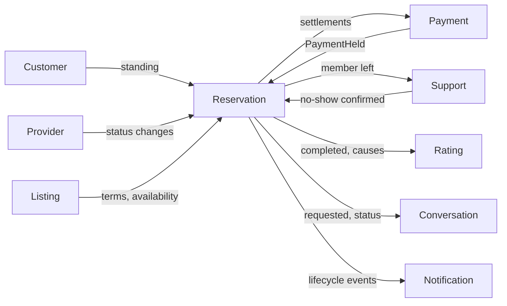

# Homa Business Rule Development Plan

> Ingested from Notion on 2026-11-20: https://app.notion.com/p/41e8436ade40813b9820f4e604494d7c
> The Notion page is the source of truth; refresh this copy when it changes.

Development plan for the [Homa Business Rule](homa-business-rule.md) page, as of 21 Nov 2026.

## Summary and key decisions

Homa splits into **8 bounded contexts**. **Reservation** is the core domain and owns every fee and fine formula. **Payment** moves the money; it never decides an amount. Contexts talk only through `ie/` events, so Reservation keeps local read models of provider, team and customer state. Everything is one Maven project (a single pom.xml, Java + Spring Boot) with a single src/main/java, one package root per bounded context, and ArchUnit tests in CI enforcing the boundaries (see Source layout).

The decisions that shape everything else:

1. **Money rules live in the Reservation domain.** Fees, fines, refunds and compensation (RES-6, §6, §7, RPT-9, ROS-8, SUS-3) are worked out by `SettlementPolicy` objects. The result is a `Settlement` value object that carries the CAN-2 cap and the PAY-8 rounding rule: each line is rounded once, and the refund is the amount paid minus the rounded fee. Payment executes the `Settlement` it receives in an event and never re-derives it.
2. **Terms are snapshotted.** A `ReservationTerms` value object is frozen when the reservation is Requested (RES-8). Policies read only the snapshot, never the live listing. Edits re-price with the same snapshot, and the booking discount survives a smaller roster (REQ-1, ROS-8).
3. **Calendar exclusivity is its own aggregate.** `ProviderSchedule` (RES-9, with buffer) and `CustomerSchedule` (RES-10, without buffer) hold the active blocks. Optimistic locking prevents double booking. A database exclusion constraint is only a safety net; the rule stays in the domain.
4. **Phases come from time, not status.** Stored statuses follow the rules exactly: Requested, Reserved, Completed, Declined, Expired, Cancelled. Completed is not final: a Provider No Show confirmed inside the protection window turns it into Cancelled (NSH-6). The checkout hold (RES-11) is a schedule hold, not a status. `ReservationPhase` (BeforeCheckIn, CheckIn, InJob, PostJob, Closed) is computed from `JobTime` and a `Clock`. Every time-based rule asks the phase.
5. **Cancellation reason is a value, not a status.** `Cancelled` carries a `CancellationCause` (CustomerCancelled, ProviderCancelled, NoRoster, ProviderNoShow, CustomerNoShow, CustomerSuspended, ProviderSuspended, LastMinute…). Reliability counts (RTG-10) and settlement read the cause.
6. **Reports live in Support; effects live where the state is.** Support owns a report's lifecycle and Support's confirmation. Reservation applies the money effect when it receives `ProviderNoShowConfirmed` or a similar event. Roster Member Left goes the other way: Reservation records the fact first (it changes the roster and the money), and Support creates the report automatically so it can be disputed (ROS-10, RPT-10).
7. **Time-driven rules enter through schedulers.** `infra/transport/messaging` triggers call ordinary usecase ports: expire requests, lock the roster at check-in, remind about completion, release payouts, close rating windows. All times are Asia/Kuala_Lumpur through an injected `Clock`.
8. **The rule cases are the test suite.** Each rule ID gets one intent-named test built from the §0 fixture (Aisyah, Kemas Home, the RM200 reservation). The §10 table becomes one parameterised settlement test.

## Bounded contexts and context map

Every rule ID has exactly one owning context. Where a rule touches two contexts, the owner is the one whose aggregate enforces the invariant, and the other context reacts to an event.

| Context | Subdomain | Owns rules | Aggregates (roots) | Package root |
| --- | --- | --- | --- | --- |
| Reservation | Core | RES-1–12, REQ-1–9, ACC-1–3, ROS-1–10, JOB-1–6, CAN-1–3, CCX-1–6, PCX-1–2, NRS-1–3, LMC-1–3, SUS-1–3, NSH-3, NSH-5, NSH-6, CUS-5 (effect) | Reservation, ProviderSchedule, CustomerSchedule | `com.homa.reservation` |
| Payment | Supporting | PAY-1–11 | PaymentHold, Payout, ProviderFineAccount, Ledger | `com.homa.payment` |
| Provider | Supporting | PRV-1–6, HLP-1–8, MON-1–4 | Provider, TeamMember | `com.homa.provider` |
| Listing | Supporting | OFR-1–10 | ProviderListing, AvailabilitySchedule, Preset | `com.homa.listing` |
| Customer | Supporting | CUS-1–4, CUS-6 | Customer | `com.homa.customer` |
| Support | Supporting | RPT-1–11, NSH-1, NSH-2, NSH-4 | Report | `com.homa.support` |
| Rating | Supporting | RTG-1–11 | RatingSession, ReliabilityRecord | `com.homa.rating` |
| Conversation | Supporting | CHT-1–5 | Conversation | `com.homa.conversation` |
| Notification | Generic | Notify on events (ROS-1, JOB-4, NRS-1, reminders) | none (routing only) | `com.homa.notification` |
| Identity | Generic | Phone OTP, roles (customer, provider staff, Support) | buy: Cognito or similar | `infra.security` in each context + `com.homa.app` |

Why these boundaries:

- **Provider and Listing are split.** Provider is compliance: identity, permits, re-verification, suspension. Listing is commerce: prices, settings, availability. They change for different reasons and at different rates. One aggregate for both would lock pricing edits behind KYC state.
- **Scheduling stays inside Reservation.** RES-9 and RES-10 must hold in the same transaction that creates the reservation. Across contexts that would need a saga with a race window, so `ProviderSchedule` lives beside `Reservation`.
- **Notification and Identity have no Homa rules.** They are generic subdomains, so the plan buys or thinly wraps them and keeps them out of the core.



## Source layout

Homa is one Maven project (one pom.xml) with a single `src/main/java`. Each bounded context is a package root with the skill's `domain`, `usecase` and `infra` layers inside it. The compiler won't stop a wrong import, so ArchUnit tests do: they are written in slice 0, before any domain code, and a failing rule blocks the merge.

Build plugins in the `pom.xml`: `spring-boot-maven-plugin` (the one deployable), `maven-surefire-plugin` (unit and ArchUnit tests), `maven-failsafe-plugin` (Testcontainers integration tests, `*IT.java`), `jacoco-maven-plugin` (coverage, which feeds the CRAP check), and `pitest-maven` (mutation gates, scoped per package: kernel and domain at least 90%, use case at least 80%). Test dependencies: `archunit-junit5`, `testcontainers`, `wiremock`.

```txt
src/main/java/com/homa/
├── kernel/                  Money, Percentage, TimeInterval
├── ie/
│   ├── port/                ReservationIE, PaymentIE, ...
│   └── events/              ReservationRequestedIE, ...
├── reservation/
│   ├── domain/              Reservation, JobTime, settlement/, schedule/, replica/, exception/
│   ├── usecase/             port/in, port/out, dto/, exception/, ie/, *.java
│   └── infra/               persistent/, transport/{controller,messaging,client}/, security/, event/
├── payment/                 same three layers
├── provider/  listing/  customer/  support/  rating/  conversation/  notification/
└── app/                     HomaApplication, wiring of infra to ports, transaction decorators

src/test/java/com/homa/
├── architecture/            ArchitectureTest (the rules below)
├── fixtures/                HomaFixtures: Aisyah, Kemas Home, the RM200 reservation
└── <context>/...            tests mirror the main packages
```

The rules that replace module boundaries:

| # | Rule | Skill pillar it protects |
| --- | --- | --- |
| 1 | `kernel` depends only on `java..` | kernel is JDK-only |
| 2 | `ie` depends only on `kernel` and `java..` | events carry primitives and kernel types |
| 3 | `*.domain` depends only on its own context's domain, `kernel` and `java..` | domain imports nothing else, no framework |
| 4 | `*.usecase` never depends on `*.infra`, Spring, Jakarta or a cloud SDK | usecase reaches the outside only through `port/out` |
| 5 | Contexts don't depend on each other; only `kernel`, `ie` and `app` are shared, and only `app` may see every context | contexts talk only through `ie` events |
| 6 | `infra.transport.controller` doesn't depend on `domain` or on use case implementations, only on `usecase.port.in` and `usecase.dto` | domain objects never cross transport |
| 7 | Implementations of `*IEHandler` live in `usecase.ie`, and only `infra.event` calls them | one handler per event, listener injects the interface |

```java
@AnalyzeClasses(packages = "com.homa", importOptions = ImportOption.DoNotIncludeTests.class)
class ArchitectureTest {

  @ArchTest static final ArchRule kernelIsJdkOnly = classes()
      .that().resideInAPackage("com.homa.kernel..")
      .should().onlyDependOnClassesThat().resideInAnyPackage("com.homa.kernel..", "java..");

  @ArchTest static final ArchRule ieIsContractOnly = classes()
      .that().resideInAPackage("com.homa.ie..")
      .should().onlyDependOnClassesThat().resideInAnyPackage("com.homa.ie..", "com.homa.kernel..", "java..");

  @ArchTest static final ArchRule domainIsPure = noClasses()
      .that().resideInAPackage("com.homa.*.domain..")
      .should().dependOnClassesThat().resideInAnyPackage(
          "..usecase..", "..infra..", "com.homa.ie..", "com.homa.app..",
          "org.springframework..", "jakarta..", "com.fasterxml..");

  @ArchTest static final ArchRule usecaseHasNoInfra = noClasses()
      .that().resideInAPackage("com.homa.*.usecase..")
      .should().dependOnClassesThat().resideInAnyPackage(
          "..infra..", "com.homa.app..", "org.springframework..", "jakarta..", "software.amazon..");

  @ArchTest static final ArchRule contextsAreIsolated = slices()
      .matching("com.homa.(*)..").namingSlices("$1")
      .should().notDependOnEachOther()
      .ignoreDependency(resideInAPackage("com.homa.app.."), alwaysTrue())
      .ignoreDependency(alwaysTrue(), resideInAnyPackage("com.homa.kernel..", "com.homa.ie.."));

  @ArchTest static final ArchRule controllersUsePortsOnly = noClasses()
      .that().resideInAPackage("com.homa.*.infra.transport.controller..")
      .should().dependOnClassesThat().resideInAPackage("com.homa.*.domain..")
      .orShould().dependOnClassesThat(resideInAPackage("com.homa.*.usecase..")
          .and(not(resideInAnyPackage("com.homa.*.usecase.port.in..", "com.homa.*.usecase.dto.."))));
}
```

Rule 3 as written stops a domain from reaching out of the domain layer. Rule 5 stops it reaching another context's domain, so together they give "own context, kernel and JDK only". Rule 7 is a naming check added alongside the handler interfaces in slice 1.

**When to split into Maven modules.** Move a context into its own module when a second developer joins, or when it must deploy on its own (Payment first, for PCI scope). Because the packages already follow the module layout, the move is mechanical: add a parent pom with a `<module>` per context, move the package into it, and turn its ArchUnit rules into declared `<dependency>` entries.

## Kernel and integration events

`kernel/` gets only three types. Each one is used by two or more contexts, has no Homa-specific rule, and needs only the JDK.

Only two event streams flow back into Reservation: `PaymentHeldIE` and the no-show confirmations. Provider also listens to Reservation events to count open reservations for PRV-5.

| Type | Shape | Used by | Notes |
| --- | --- | --- | --- |
| `Money` | `BigDecimal`  • currency (MYR) | Reservation, Payment, Listing, Support | Arithmetic stays exact. `roundedToSen()` rounds HALF_UP to 2 dp, and only when a settlement line is produced (PAY-8: 39.375 becomes RM39.38). |
| `Percentage` | `BigDecimal` from 0 to 100 | Reservation, Payment, Listing | `of(Money)` and `complement()` (1 − p, for the discount) |
| `TimeInterval` | `Instant start`, `Instant end` | Reservation, Listing, Rating, Support | `overlaps`, `contains`, `duration`, `extendEnd(Duration)` |

Not admitted to the kernel: quarter-hour rounding (only Reservation needs it), city codes (Homa presets carry business meaning), and IDs (each context wraps its own, and events carry Strings).

### Integration event catalog

The `ie/port` interfaces are `CustomerIE`, `ProviderIE`, `ListingIE`, `ReservationIE`, `PaymentIE`, `SupportIE` and `RatingIE`. Each context has one publisher. Events carry Strings, `Money`, `Percentage`, `Instant` and enums as Strings, never domain objects.

| Event (`ie/events`) | Publisher | Consumers | Key payload |
| --- | --- | --- | --- |
| `CustomerRegisteredIE`, `CustomerAddressChangedIE` | Customer | Reservation, Conversation | customerId, city, status |
| `CustomerSuspendedIE`, `CustomerReactivatedIE` | Customer | Reservation (CUS-5), Conversation | customerId, at |
| `ProviderWentLiveIE` | Provider | Listing, Reservation, Payment | providerId, businessRegistrationNo |
| `ProviderClosedIE` | Provider | Listing, Reservation, Payment (fine becomes debt, PAY-9) | providerId, businessRegistrationNo |
| `ProviderSuspendedIE`, `ProviderReactivatedIE` | Provider | Listing, Reservation (SUS-1–3) | providerId, cause = MISSED_REVERIFICATION or MONITORING_FLAG, at |
| `ProviderBookabilityChangedIE` | Provider | Listing, Reservation, Notification (PRV-6) | providerId, bookable, reason = NO_ACTIVE_HELPERS |
| `InsuranceCoverageChangedIE` | Provider | Listing, Support (RPT-7) | providerId, covered, validUntil |
| `TeamMemberActivatedIE`, `TeamMemberDeactivatedIE`, `TeamMemberPermitUpdatedIE` | Provider | Reservation, Listing (default max helpers) | memberId, providerId, role, citizen/foreign, permitExpiry |
| `TeamMemberSuspendedIE`, `TeamMemberReactivatedIE` | Provider | Reservation (ROS-5, ROS-9, ROS-10) | memberId, cause, at |
| `ListingTermsChangedIE` | Listing | Reservation, Notification (OFR-6 notice raised) | full snapshot: cities, jobs, rate, travel fee, discount, bounds, notice, buffer, policy, tier; noticeRaised |
| `AvailabilityChangedIE`, `ExternalBusyTimeSyncedIE` | Listing | Reservation | providerId, weekly hours, busy intervals |
| `ReservationCheckoutStartedIE` | Reservation | Payment | checkoutId, customerId, total, holdExpiresAt (RES-11) |
| `ReservationCheckoutRejectedIE` | Reservation | Payment (full refund at once), Notification | checkoutId, reason (RES-12) |
| `ReservationRequestedIE`, `ReservationReservedIE` | Reservation | Payment, Conversation, Notification, Provider (PRV-5 open count) | reservationId, parties, jobTime, total, protectionWindowEnd |
| `ReservationTopUpRequestedIE` | Reservation | Payment | reservationId, editId, top-up amount, expiresAt (REQ-1, REQ-6) |
| `ReservationEditedIE` | Reservation | Payment (refunds a lower price at once), Notification | reservationId, new total, difference |
| `ReservationEditDroppedIE` | Reservation | Payment (closes the top-up, or refunds one that arrived late, REQ-8, REQ-9), Notification (REQ-6) | reservationId, editId |
| `ReservationDeclinedIE`, `ReservationExpiredIE` | Reservation | Payment (full refund), Conversation (read-only, CHT-5), Notification, Provider | reservationId |
| `RosterChangedIE` | Reservation | Notification (ROS-1), Support | reservationId, member ids |
| `ReservationCancelledIE` | Reservation | Payment, Rating (RTG-10; voids and removes ratings for NSH-6), Conversation (CHT-5), Notification, Provider | cause, settlement lines, protectionWindowEnd |
| `RosterMemberLeftIE` | Reservation | Support (auto-report), Rating, Payment, Notification | memberId, leftAt, reason, refund |
| `SettlementAdjustedIE` | Reservation | Payment | reservationId, adjustment lines (ROS-8, RPT-10 dispute) |
| `ReservationCompletedIE` | Reservation | Payment, Rating (opens the window, RTG-2), Notification (JOB-4) | payout gross, protectionWindowEnd, completedAt |
| `PaymentHeldIE`, `PaymentFailedIE` | Payment | Reservation | checkoutId, amount, paidAt |
| `TopUpHeldIE`, `TopUpFailedIE` | Payment | Reservation | reservationId, editId, paidAt |
| `RefundPaidIE`, `PayoutReleasedIE` | Payment | Notification | amounts |
| `ProviderDebtChangedIE` | Payment | Provider (PAY-9) | businessRegistrationNo, outstanding debt, outstanding fine, pending payout count (PAY-9, PAY-11) |
| `ReportOpenedIE`, `ReportResolvedIE` | Support | Payment (RPT-6 hold) | reportId, reservationId |
| `ProviderNoShowConfirmedIE`, `CustomerNoShowConfirmedIE` | Support | Reservation (NSH-3, NSH-5, NSH-6) | reservationId, confirmedAt |
| `RosterMemberLeftDisputeResolvedIE` | Support | Reservation | reservationId, memberId, corrected leftAt |
| `ProviderRatingRevealedIE`, `ReliabilityChangedIE` | Rating | Listing (provider page) | averages, counts |

## Domain model per context

The domain layer holds every rule that would still be true if the app's screens and endpoints were rewritten. Each object below names the rule IDs it enforces on itself. Domain imports only `kernel/`.

### Reservation (core)

```txt
reservation/domain/
├── Reservation.java              AR
├── ReservationId.java
├── ReservationStatus.java        REQUESTED, RESERVED, COMPLETED, DECLINED, EXPIRED, CANCELLED
├── CancellationCause.java
├── ReservationPhase.java         derived from JobTime + now
├── JobTime.java                  start + QuarterHourDuration
├── QuarterHourDuration.java      RES-5
├── BillableTime.java             worked time rounded up to 15-min steps
├── ServiceAddress.java           address, city, arrival note (snapshot)
├── JobSelection.java             non-empty set of job codes
├── terms/
│   ├── ReservationTerms.java     frozen snapshot (RES-8)
│   ├── DiscountRule.java
│   ├── AcceptancePolicy.java     INSTANT, REQUEST
│   ├── AcceptanceDeadline.java   ACC-3
│   └── CancellationTier.java     FLEXIBLE 4h, STANDARD 12h, FIRM 24h
├── pricing/
│   ├── Quote.java                hoursFee, travelFee, total, baseCancellationFee
│   └── ReservationPricing.java   domain service, RES-6
├── roster/
│   ├── Roster.java               entity inside Reservation
│   ├── RosterMember.java         memberId, HELPER or SUPERVISOR
│   ├── RosterProposal.java       ROS-8 smaller roster
│   └── MemberDeparture.java      memberId, leftAt, reason
├── settlement/
│   ├── Settlement.java           lines + CAN-2 cap
│   ├── SettlementPolicy.java     interface
│   └── *Policy.java              one per money rule (table below)
├── schedule/
│   ├── ProviderSchedule.java     AR, RES-9
│   └── CustomerSchedule.java     AR, RES-10
├── replica/
│   ├── BookableProvider.java     Listing + Provider state as Reservation sees it
│   ├── RosterableMember.java
│   └── CustomerStanding.java
└── exception/
```

**`JobTime`** answers every time question, so no usecase ever does date arithmetic:

- `checkInPeriod()` is [start − 15 min, start).
- `protectionWindow()` is [check-in start, end + 24 h).
- `noticeFrom(now)` is check-in start − now (RES-4).
- `calendarBlock(buffer)` is [check-in start, end + buffer) (RES-9).
- `phaseAt(now)` returns BeforeCheckIn, CheckIn, InJob, PostJob or Closed.

**`Reservation` behaviour and the rules it enforces:**

| Method | Allowed when | Rules | Result |
| --- | --- | --- | --- |
| `ProviderSchedule.hold(checkoutId, block, now)` | provider admits the request; no overlapping block or live hold | RES-1–5, RES-9, RES-10, RES-11, ACC-3 | hold that expires after 15 min |
| `request(...)` (factory, on payment held) | hold still live; or hold expired but the time is still free and every booking rule still passes | RES-7, RES-12, ACC-1, ACC-3 | REQUESTED with terms snapshot and quote, RESERVED at once when INSTANT; otherwise rejected with a full refund |
| `edit(...)` | REQUESTED, no pending edit; new time meets notice; same terms snapshot; a price rise is refused in the last 15 min before the deadline (REQ-7) | REQ-1, REQ-5 | lower price: applied at once with a refund line. Higher price: a `PendingEdit` for at most 15 min, which keeps the original time blocked and holds any changed time (REQ-6) |
| `applyTopUp(editId, now)` | pending edit with the top-up held within 15 min; or a late top-up while still REQUESTED and every rule passes (REQ-8), otherwise it is refunded | REQ-1, REQ-6 | edit applied; deadline recomputed from now |
| `dropPendingEdit(now)` | 15 min passed, or the top-up failed | REQ-6 | reservation unchanged; extra hold released |
| `accept(now)` | REQUESTED, no pending edit, now before the deadline | ACC-2, REQ-6 | RESERVED, `reservedAt` set |
| `decline()`, `expire(now)` | REQUESTED, no pending edit for decline; expire only after the deadline | REQ-3, REQ-4, REQ-6 | DECLINED or EXPIRED, full refund |
| `cancelByCustomer(now)` | REQUESTED (free; drops any pending edit and refunds a late top-up, REQ-9), or RESERVED before job end | REQ-2, CCX-1–6, LMC-1, LMC-2 | CANCELLED + `Settlement` |
| `cancelByProvider(now)` | RESERVED, before job end | PCX-1, PCX-2, LMC-3, RPT-11 | CANCELLED + `Settlement` |
| `assignRoster(members, now)` | BeforeCheckIn; members rosterable; helpers = booked count | ROS-1–4, ROS-6 | roster change, customer notified |
| `proposeSmallerRoster`, `acceptProposal` | BeforeCheckIn | ROS-8 | re-quoted keeping the booking discount; difference refunded |
| `lockRosterAtCheckIn(now)` | phase reaches CheckIn | ROS-1, ROS-5, ROS-7, NRS-1–3 | locked, or CANCELLED (NO_ROSTER) + `Settlement` |
| `recordMemberLeft(member, at, reason)` | CheckIn or InJob; at least one helper stays | RPT-8, RPT-9, RPT-11, ROS-10 | departure + partial refund `Settlement` |
| `markCompleted(photos, now)` | RESERVED, now at or after job end, at least 1 photo | JOB-3 | COMPLETED |
| `applyProviderNoShow()` | RESERVED, or COMPLETED inside the protection window; report confirmed | NSH-3, NSH-6 | CANCELLED + `Settlement` |
| `applyCustomerNoShow()` | RESERVED, report confirmed | NSH-5 | CANCELLED + `Settlement` |
| `cancelForCustomerSuspension(now)` | phase is BeforeCheckIn | CUS-5 | CANCELLED, full refund, no fine |
| `cancelForProviderSuspension(now, cause)` | BeforeCheckIn: MISSED_REVERIFICATION is a provider cancellation by timing; MONITORING_FLAG is a full refund, no fine. In job: MISSED_REVERIFICATION defers, MONITORING_FLAG stops | SUS-1–3 | CANCELLED or job stopped + `Settlement` |

**Settlement policies.** Each policy is a small strategy that returns a `Settlement`. `Settlement` is a value object with these lines: customerFee, customerRefund, compensation, providerFine, providerPayoutGross. Its constructor applies CAN-2: the fee and the fine are each capped at the Total Reservation Fee, and refund + fee equals the amount held. Every line is computed exactly and rounded once to the sen, half up, and the refund is derived as paid minus the rounded fee (PAY-8).

| Policy | Rules | Formula on the standard reservation |
| --- | --- | --- |
| `FreeCancellationPolicy` | REQ-2–4, CCX-1, CCX-3–5, CUS-5, SUS-1 (monitoring flag) | refund 200 |
| `LateCustomerCancellationPolicy` | CCX-6 | fee = base 45, refund 155 |
| `ProviderCancellationPolicy` | PCX-1, PCX-2, SUS-1 (missed re-verification) | fine 45 or 45 + 10%; compensation 0 or 3% |
| `NoRosterPolicy` | NRS-2, NRS-3 | fine 45 + 12% = 69; compensation 4% = 8 |
| `CustomerLastMinutePolicy` | LMC-1, LMC-2 | base + `BillableTime` after hour 1 × discounted all-helper rate + travel |
| `ProviderLastMinutePolicy` | LMC-3 | fine 45 + 20% = 85; compensation 7% = 14 |
| `ProviderNoShowPolicy` | NSH-3, NSH-6 | fine 45 + 30% = 105; compensation 10% = 20 |
| `CustomerNoShowPolicy` | NSH-5 | base + 30% × Hours Fee after hour 1 + travel = 105.50 |
| `MidJobStopPolicy` | SUS-3 | refund = unbilled time × discounted all-helper rate; no fine |
| `MemberLeftPolicy` | RPT-9, ROS-10 | refund = that helper's unbilled time × discounted per-helper rate; 0 for a supervisor |
| `SmallerRosterPolicy` | ROS-8 | re-quote keeping the booking discount: 25 × 4 × 1 × 0.9 + 20 = 110, refund 90 |

**Schedules.** `ProviderSchedule.block(reservationId, interval)` rejects any overlap with an active block (RES-9). `CustomerSchedule.block(...)` checks job time only (RES-10). Blocks are released on Declined, Expired, Cancelled and Completed. A checkout hold is a block with a 15-minute expiry (RES-11); an expired hold no longer counts as an overlap, so no cleanup job is needed for correctness. A payment that lands after expiry re-runs the overlap check and every booking rule before the reservation is made (RES-12).

**Replicas.** `BookableProvider.admits(request, now)` checks bookability (PRV-6), city coverage, hour and helper bounds (max helpers is the smaller of the setting and the active helper count), notice, job time inside working hours (check-in and buffer may fall outside, RES-3) and external busy time. `RosterableMember.canWorkOn(jobEnd)` checks active status and the permit rule, job end ≤ permit expiry − 90 days (ROS-3, ROS-4).

### Payment

| Object | Kind | Rules | Behaviour |
| --- | --- | --- | --- |
| `PaymentHold` | AR per reservation | PAY-1, PAY-4, PAY-7, REQ-1, RES-12 | `hold`, `topUp(amount)`, `refund(amount)` (never more than held), `refundRejectedCheckout()`, `applySettlement` |
| `Payout` | AR per reservation | PAY-2, PAY-3, PAY-6, RPT-6 | kind JOB or FEE; `markCompleted`, `reportOpened` and `reportResolved`; `releasableAt(now)`; platform fee 15.5% on JOB only |
| `ProviderFineAccount` | AR per business registration number | PAY-4, PAY-5, PAY-9–11 | fines oldest first; `deductFrom(payoutAfterPlatformFee)` takes at most 20%, on every payout kind; a suspension leaves the balance as a fine; `closeAccount()` lifts the 20% cap so pending payouts clear the fine in full; what is left after the last pending payout becomes `Debt`; `settleDebt(directPayment)` and `settleFineToRejoin(directPayment)`, for a closed provider rejoining while payouts are pending (PAY-11), are the only direct charges |
| `Ledger`, `LedgerEntry` | AR, double entry | PAY-4 | accounts: customer held, provider payable, Homa revenue (platform fee + fine minus compensation), Homa compensation expense, fine receivable |
| `PlatformFeeRate` | VO, 15.5% | PAY-3 | business constant, not configuration |

### Provider

| Object | Kind | Rules | Behaviour and invariants |
| --- | --- | --- | --- |
| `Provider` | AR | PRV-1, PRV-2, PRV-4–6, MON-1–4, PAY-9 | `register` refuses while the business registration has debt, or has payouts still pending and an unpaid fine (PAY-9, PAY-11); `goLive(activeHelperCount)` needs at least 1; `bookabilityFor(activeHelperCount)` turns false at 0 (PRV-6); `close(openReservations)` needs 0; `suspend(cause)`; `reverify(at)`; `reactivate` is automatic after MON-3 (fines don't block it) and needs Support after MON-4 |
| `TeamMember` | AR (one per person) | HLP-1–8, MON-1–4 | role HELPER or SUPERVISOR; `Eligibility` is `Citizen` or `ForeignWorker(permitExpiry, employmentConfirmed)`; `isActive()` = verified, not suspended and not deactivated; `reactivate` needs valid verification |
| `VerificationCycle` | VO | MON-1, MON-2 | `dueAt` = date passed + 6 months; reminders from due − 60 days; monitoring deadline = flag + 14 days |
| `AgeRequirement`, `PermitRequirement` | VO | HLP-1, HLP-3 | at least 18 years old; permit at least 90 days from verification |
| `InsurancePolicy` | VO | PRV-4 | `coversOn(date)`, confirmed by Support |
| `OpenReservationCount`, `RegistrationDebt` | replicas | PRV-5, PAY-9 | kept up to date from Reservation and Payment events |

### Listing

| Object | Kind | Rules | Behaviour and invariants |
| --- | --- | --- | --- |
| `ProviderListing` | AR | OFR-1–7, OFR-9, OFR-10 | jobs, tools and cities only from presets; rate > 0; exactly one policy and one tier; notice never below the policy's floor; `choosePolicy(REQUEST)` raises a notice under 2 h to 2 h and flags it for a notification (OFR-6); any change publishes a full terms snapshot |
| `TravelFeePolicy` | VO | OFR-3 | None, Flat, or ByCity (must price every covered city) |
| `DiscountRule` | VO | OFR-4 | rate, min hours, min helpers; none by default |
| `BookingBounds` | VO | OFR-5 | hours 1–8 by default in 15-min steps; helpers from 1 to the active helper count by default |
| `MinimumNotice` | VO | OFR-6 | 2 h by default; floor 1 h for Instant, 2 h for Request |
| `JobBuffer` | VO | OFR-10 | 30 min by default |
| `AvailabilitySchedule` | AR | OFR-8 | weekly hours + busy intervals synced from external calendars |
| `Preset` | AR (Homa admin) | OFR-1 | job types, tools, cities |

### Customer

`Customer` (AR) is built only through `register(verifiedPhone, userName, HomeAddress, arrivalNote, termsAcceptance)`. Every argument is required (CUS-1, CUS-2). `suspend(reason)` and `reactivate()` cover CUS-4 and CUS-6. `HomeAddress` carries the city code that Reservation copies for RES-1.

### Support

`Report` (AR) is created by `Report.open(reporterRole, category, description, evidence, ReservationWindow, now)`.

- `ReportCategory.allowedFor(role)` enforces RPT-2.
- The description must not be empty (RPT-3).
- The report must fall inside the protection window (RPT-1).
- A no-show report must come after check-in ends (NSH-2, NSH-4).
- Customer No Show needs `ArrivalEvidence`: a photo and a location (NSH-4).

States are OPEN, then CONFIRMED, REJECTED or RESOLVED. Roster Member Left is auto-resolved when the protection window ends, unless the customer disputes it before then (RPT-10). A Provider No Show report is still accepted after the job was marked Completed (NSH-6). `ReservationWindow` is a replica holding the parties, check-in, job time and protection window.

### Rating

`RatingSession` (AR per reservation) exists only for Completed reservations (RTG-9). It opens when the job is marked Completed and closes 7 days after the protection window ends (RTG-2). `submit(Rating)` checks direction-specific categories (RTG-7, RTG-8) and allows media only from customer to provider (RTG-5). `revealedAt` is the moment both ratings are in or the window closes (RTG-3). `voidForProviderNoShow()` covers NSH-6 and `remove(ratingId)` covers RTG-11.

`ReliabilityRecord` (AR per party) stores dated incidents and returns counts over the trailing 12 months, filtered by which causes count (RTG-10).

### Conversation

`Conversation` (AR) is either an `ENQUIRY` or a `RESERVATION` conversation. `startEnquiry` accepts only a customer in good standing (CHT-1, CUS-5). Reservation chat accepts messages from both sides from Requested until the protection window ends (CHT-2). It turns read-only then, or at once when the reservation is Declined, Expired or cancelled before check-in starts; anything new goes through a new Enquiry (CHT-5). Writability is computed from a `ReservationChatWindow` replica (status + window end) and the clock, so no scheduler is needed. The off-platform warning (CHT-3) is UI copy, not a domain rule.

## Use cases per context

A use case loads aggregates through `port/out`, calls domain behaviour, saves, and publishes one event. It also owns application policy: who may act, and what happens next. It never computes a fee and never compares times itself; it asks `JobTime`, a policy or an aggregate.

Naming follows the skill: the interface is the actor (`ReservationAccepter`), the implementation is the action (`ProviderAcceptReservation`). Each use case has its own `dto/` request and response. Transactions wrap use cases through a decorator wired in `app/`, so `usecase/` carries no Spring annotation.

### Reservation

```txt
reservation/usecase/
├── port/in/      *er / *or interfaces + *IEHandler interfaces
├── port/out/     ReservationRepository, ProviderScheduleRepository,
│                 CustomerScheduleRepository, BookableProviderRepository,
│                 RosterableMemberRepository, CustomerStandingRepository,
│                 CompletionPhotoStore, ReservationIEPublisher, TimeSource
├── dto/          one request/response pair per use case
├── exception/    ReservationNotFound, NotReservationParty, CheckoutExpired
├── ie/           Handle*IE implementations
└── *.java        use case implementations
```

| Interface (`port/in`) | Implementation | Trigger | Rules |
| --- | --- | --- | --- |
| `AvailableStartFinder` | `FindAvailableStartTimes` | API query | RES-3, RES-4, RES-5, RES-9, OFR-6 |
| `ReservationQuoter` | `QuoteReservation` | API query | RES-6, OFR-4 |
| `ReservationCheckoutStarter` | `CustomerStartReservationCheckout` | API | RES-1–5, RES-10, RES-11, ACC-3 |
| `ReservationEditor` | `CustomerEditReservation` | API | REQ-1, REQ-5, REQ-6, REQ-7; publishes `ReservationEditedIE` (lower price) or `ReservationTopUpRequestedIE` (higher price) |
| `UnpaidEditDropper` | `DropUnpaidEdits` | scheduler, every minute | REQ-6; publishes `ReservationEditDroppedIE` |
| `ReservationAccepter` | `ProviderAcceptReservation` | API | ACC-2, REQ-6 (blocked while a top-up is pending) |
| `ReservationDecliner` | `ProviderDeclineReservation` | API | REQ-3, REQ-6 |
| `OverdueRequestExpirer` | `ExpireOverdueRequests` | scheduler, every minute | REQ-4 |
| `CustomerCancellationPreviewer` | `PreviewCustomerCancellation` | API query (shows the fee before confirming) | CCX-1–6, LMC-1 |
| `CustomerReservationCanceller` | `CustomerCancelReservation` | API | REQ-2, REQ-9, CCX, LMC-1, LMC-2 |
| `ProviderReservationCanceller` | `ProviderCancelReservation` | API | PCX-1, PCX-2, LMC-3 |
| `RosterAssigner` | `ProviderAssignRoster` | API | ROS-1–6 |
| `SmallerRosterProposer` | `ProviderProposeSmallerRoster` | API | ROS-8 |
| `SmallerRosterResponder` | `CustomerRespondToSmallerRoster` | API | ROS-8 |
| `CheckInRosterLocker` | `LockRostersAtCheckIn` | scheduler | ROS-1, ROS-7, NRS-1–3 |
| `RosterMemberLeftRecorder` | `ProviderRecordRosterMemberLeft` | API | RPT-8, RPT-9, RPT-11 |
| `ReservationCompleter` | `ProviderCompleteReservation` | API | JOB-3; its event opens ratings (RTG-2) |
| `UncompletedJobReminder` | `RemindUncompletedJobs` | scheduler at end and end + 2 h | JOB-5 |
| `ReservationViewer`, `ReservationLister` | `ViewReservation`, `ListMyReservations` | API query | ROS-6 |

Event handlers (`usecase/ie/`, one per event):

| Handler implementation | Reacts to | Effect |
| --- | --- | --- |
| `HandlePaymentHeldIE` | `PaymentHeldIE` | live hold: REQUESTED (RES-7), RESERVED if Instant (ACC-1). Expired hold: re-checks the slot and every booking rule; passes become REQUESTED, failures publish `ReservationCheckoutRejectedIE` (RES-12) |
| `HandlePaymentFailedIE` | `PaymentFailedIE` | releases the checkout hold (RES-11) |
| `HandleTopUpHeldIE`, `HandleTopUpFailedIE` | Payment | applies the pending edit, or drops it and notifies (REQ-6). A late top-up re-checks every rule and applies the edit, or publishes `ReservationEditDroppedIE` so Payment refunds it (REQ-8); after a cancellation it is always refunded (REQ-9) |
| `HandleListingTermsChangedIE`, `HandleAvailabilityChangedIE`, `HandleExternalBusyTimeSyncedIE` | Listing events | update `BookableProvider` only; existing reservations keep their terms (RES-8) |
| `HandleProviderWentLiveIE`, `HandleProviderClosedIE`, `HandleProviderBookabilityChangedIE` | Provider events | bookable on or off (PRV-6) |
| `HandleProviderSuspendedIE` | `ProviderSuspendedIE` | SUS-1: before check-in, missed re-verification is a provider cancellation and a flag is a free refund. SUS-2 defers; SUS-3 stops the job |
| `HandleTeamMemberSuspendedIE` | `TeamMemberSuspendedIE` | ROS-5 flags rosters to fix; ROS-9 defers; ROS-10 records the member as left |
| `HandleTeamMemberDeactivatedIE`, `...ActivatedIE`, `...PermitUpdatedIE`, `...ReactivatedIE` | Provider events | `RosterableMember` replica; ROS-5 when rostered |
| `HandleCustomerSuspendedIE` | `CustomerSuspendedIE` | CUS-5 cancels before check-in; in-job reservations continue |
| `HandleCustomerRegisteredIE`, `HandleCustomerReactivatedIE`, `HandleCustomerAddressChangedIE` | Customer events | `CustomerStanding` replica |
| `HandleProviderNoShowConfirmedIE` | Support | NSH-3 settlement, including from COMPLETED (NSH-6) |
| `HandleCustomerNoShowConfirmedIE` | Support | NSH-5 settlement |
| `HandleRosterMemberLeftDisputeResolvedIE` | Support | recomputes the RPT-9 refund and publishes `SettlementAdjustedIE` |

### Payment

| Use case (interface → implementation) | Trigger | Rules |
| --- | --- | --- |
| `ReservationPayer` → `CustomerPayForReservation` | API (returns the gateway session) | PAY-1, RES-11 |
| `TopUpPayer` → `CustomerPayTopUp` | API | REQ-1, REQ-6 |
| `GatewayPaymentConfirmer` → `ConfirmGatewayPayment` | gateway webhook via `transport/messaging` | publishes `PaymentHeldIE`/`PaymentFailedIE` or `TopUpHeldIE`/`TopUpFailedIE`, with `paidAt` |
| `HandleReservationCheckoutStartedIE`, `HandleReservationTopUpRequestedIE` | event | opens a pending hold or top-up |
| `HandleReservationCheckoutRejectedIE` | event | full refund at once (RES-12) |
| `HandleReservationEditedIE`, `HandleReservationEditDroppedIE` | event | refunds a lower price at once (REQ-1); closes an unpaid top-up (REQ-6) or refunds a late one (REQ-8, REQ-9) |
| `HandleReservationDeclinedIE`, `HandleReservationExpiredIE` | event | full refund now (PAY-7) |
| `HandleReservationCancelledIE` | event | refund now; Homa pays compensation and keeps the fine's remainder (PAY-4); fine added to `ProviderFineAccount`; FEE `Payout` held until the window ends (PAY-6) |
| `HandleRosterMemberLeftIE`, `HandleSettlementAdjustedIE` | event | partial refund |
| `HandleReservationCompletedIE` | event | JOB `Payout` with the window end set |
| `HandleReportOpenedIE`, `HandleReportResolvedIE` | event | holds and frees the payout (RPT-6) |
| `HandleProviderClosedIE` | event | closed mode: pending payouts still release when due and clear the fine in full (no 20% cap); once none are left, the remainder becomes debt and it publishes `ProviderDebtChangedIE` (PAY-9). A suspension changes nothing here |
| `DebtSettler` → `ProviderSettleDebt` | API | PAY-10, PAY-11: clears debt, or a closed provider's whole outstanding fine so it can rejoin while payouts are pending (those payouts then release in full); the only direct charges |
| `DuePayoutReleaser` → `ReleaseDuePayouts` | scheduler | PAY-2, PAY-3, PAY-5, PAY-8 |

`port/out`: `PaymentGateway`, `PayoutGateway`, `PaymentHoldRepository`, `PayoutRepository`, `FineAccountRepository`, `LedgerRepository`, `PaymentIEPublisher`, `TimeSource`.

### Provider

| Use case (interface → implementation) | Trigger | Rules |
| --- | --- | --- |
| `ProviderRegistrator` → `ProviderRegisterBusiness` | API | PRV-1, PAY-9, PAY-11 (no debt, and no unpaid fine while payouts are pending) |
| `TeamMemberAdder` → `ProviderAddTeamMember` | API | HLP-1–4 |
| `TeamMemberDeactivator` / `TeamMemberReactivator` | API | HLP-5–8; re-checks bookability and publishes `ProviderBookabilityChangedIE` (PRV-6) |
| `ProviderLauncher` → `ProviderGoLive` | API | PRV-2, PRV-3 |
| `ProviderAccountCloser` → `ProviderCloseAccount` | API | PRV-5 |
| `InsurancePolicySubmitter`, `InsurancePolicyConfirmer` (Support) | API | PRV-4 |
| `InsuranceExpiryApplier` → `ExpireInsuranceCoverage` | scheduler, daily | PRV-4 |
| `Reverifier` → `SubmitReverification` | API + KYC callback | MON-1, MON-2 |
| `ReverificationReminder` → `RemindDueReverifications` | scheduler, daily | MON-1, MON-2 |
| `LapsedVerificationSuspender` → `SuspendLapsedVerifications` | scheduler | MON-3; also re-checks PRV-6 for the member's provider |
| `MonitoringResultRecorder` → `RecordMonitoringResult` | KYC webhook | MON-2, MON-4 |
| `SuspensionLifter` → `SupportReactivateAfterFlag` | API (Support role) | MON-4 |
| `HandleReservationRequestedIE` and closing events | event | `OpenReservationCount` for PRV-5 |
| `HandleProviderDebtChangedIE` | event | `RegistrationDebt` for PAY-9, PAY-11 |

`port/out`: `VerificationClient` (KYC vendor), `ProviderRepository`, `TeamMemberRepository`, `ProviderIEPublisher`, `TimeSource`.

### Listing

| Use case (interface → implementation) | Trigger | Rules |
| --- | --- | --- |
| `OfferingUpdater` → `ProviderUpdateOfferings` | API | OFR-1 |
| `PricingTermsSetter` → `ProviderSetPricingTerms` (rate, travel fee, discount) | API | OFR-2–4 |
| `BookingRulesSetter` → `ProviderSetBookingRules` (bounds, notice, buffer, policy, tier) | API | OFR-5, OFR-6 (auto-raise to 2 h on switching to Request, with a notice to the provider), OFR-9, OFR-10 |
| `ProofPhotoAdder` → `ProviderAddProofPhoto` | API | OFR-7 |
| `AvailabilitySetter`, `ExternalCalendarConnector` | API | OFR-8 |
| `ExternalCalendarSyncer` → `SyncExternalCalendars` | scheduler or webhook | OFR-8 |
| `ProviderSearcher` → `SearchProvidersByCity`, `ProviderPageViewer` | API query | RES-1, PRV-4 tag, RTG-6, RTG-10 |
| `PresetManager` (Homa admin) | API | OFR-1 |
| Handlers for Provider, TeamMember, Insurance and Rating events | event | listing visibility, active helper count, page badges |

`port/out`: `ListingRepository`, `AvailabilityRepository`, `PresetRepository`, `CalendarClient`, `ListingIEPublisher`.

### Customer

`CustomerRegistrator` → `CustomerRegisterAccount` (CUS-1, CUS-2; the OTP check goes through the `PhoneVerificationClient` port). Also `CustomerProfileUpdater`, `CustomerSuspender` → `SupportSuspendCustomer` (CUS-4), and `CustomerReactivator` → `SupportReactivateCustomer` (CUS-6). Only the Support role may call the last two, an application policy checked in the use case.

### Support

| Use case (interface → implementation) | Trigger | Rules |
| --- | --- | --- |
| `ReportFiler` → `PartyFileReport` | API | RPT-1–3, NSH-2, NSH-4, NSH-6 |
| `NoShowEvidenceResponder` → `ProviderRespondToNoShow` | API | NSH-2 |
| `NoShowAdjudicator` → `SupportConfirmNoShow`, `SupportRejectNoShow` | API (Support) | NSH-2, NSH-4, NSH-6, RPT-4 |
| `ReportResolver` → `SupportResolveReport` | API (Support) | RPT-5, RPT-7 |
| `MemberLeftDisputer` → `CustomerDisputeMemberLeft` | API | RPT-10 |
| `MemberLeftDisputeResolver` → `SupportResolveMemberLeftDispute` | API (Support) | RPT-10, CHT-4 |
| `UndisputedReportCloser` → `AutoResolveMemberLeftReports` | scheduler at window end | RPT-10 |
| `HandleRosterMemberLeftIE` | event | auto-creates the RPT-8 report |
| `HandleReservationReservedIE` and closing events | event | `ReservationWindow` replica |

### Rating

`HandleReservationCompletedIE` opens a session, and `HandleProviderNoShowConfirmedIE` voids it (NSH-6). `RatingSubmitter` → `PartySubmitRating` covers RTG-1, RTG-4, RTG-5, RTG-7 and RTG-8. `ClosedWindowRevealer` → `RevealClosedRatingWindows` is a scheduler for RTG-3. `RatingRemover` → `SupportRemoveRating` covers RTG-11. `HandleReservationCancelledIE`, `HandleRosterMemberLeftIE` and the no-show handlers feed `ReliabilityRecord` (RTG-10).

### Conversation

`EnquiryStarter` → `CustomerStartEnquiry` (CHT-1), `MessageSender` → `PartySendMessage` (CHT-2), and `ConversationViewer` → `ViewConversation`, which Support may call for evidence (CHT-4). `HandleReservationRequestedIE` opens the reservation thread, and the Declined, Expired and Cancelled handlers make it read-only at once, the last only when the cancellation came before check-in (CHT-5). Status and suspension handlers keep the replicas current.

## Key end-to-end flows

These four flows use the §0 example and cross every context boundary. Each one becomes a cross-module acceptance test.

### A. Happy path: request, accept, complete, payout

1. Aisyah calls `FindAvailableStartTimes` and `QuoteReservation`, which returns RM200.
2. `CustomerStartReservationCheckout` asks `BookableProvider.admits(...)`, then places 15-minute checkout holds (RES-11): `ProviderSchedule` for Sat 9:45–14:30 and `CustomerSchedule` for 10:00–14:00. It publishes `ReservationCheckoutStartedIE`.
3. Payment opens a pending `PaymentHold`. `CustomerPayForReservation` hands off to the gateway, and its webhook leads to `ConfirmGatewayPayment`, which publishes `PaymentHeldIE`.
4. `HandlePaymentHeldIE` checks that the hold is still live, then calls `Reservation.request(...)`: the reservation is REQUESTED with deadline Tue 20:00, and the holds become firm blocks. It publishes `ReservationRequestedIE`: Conversation opens the thread, Provider counts an open reservation, and Notification tells Kemas Home.
5. At Mon 22:00 `ProviderAcceptReservation` makes it RESERVED. The grace period runs until Tue 02:00 (CCX-1).
6. On Friday `ProviderAssignRoster` rosters Siti and Nurul, and Aisyah is notified (ROS-1).
7. At Sat 9:45 `LockRostersAtCheckIn` locks the roster.
8. At Sat 14:00 `RemindUncompletedJobs` reminds Kemas Home if the job isn't marked yet (JOB-5).
9. `ProviderCompleteReservation` uploads a photo and publishes `ReservationCompletedIE`. Payment creates a JOB `Payout` (gross RM200, releasable from Sun 14:00). Rating opens the window until the following Sunday 14:00 (RTG-2).
10. At Sun 14:00 `ReleaseDuePayouts` takes the 15.5% platform fee (RM31). Up to 20% of the remaining RM169 (RM33.80) goes to any outstanding fine (PAY-5), and the rest is sent.

### B. Late customer cancellation (Fri 22:00)

1. `PreviewCustomerCancellation` shows a RM45 fee. The Standard cut-off was Fri 21:45 and there is no grace period.
2. `CustomerCancelReservation` calls `cancelByCustomer`. `LateCustomerCancellationPolicy` returns fee 45 and refund 155. Both schedule blocks are released.
3. `ReservationCancelledIE` (cause CUSTOMER_CANCELLED_WITH_FEE) reaches Payment, which refunds RM155 now (PAY-7) and holds a FEE payout of RM45 until Sun 14:00 with no platform fee (PAY-3, PAY-6). Rating logs a customer cancellation with a fee (RTG-10). Conversation makes the chat read-only at once, because the cancellation came before check-in (CHT-5).

### C. Provider no show

1. At 10:05 Aisyah's `PartyFileReport` (PROVIDER_NO_SHOW) is accepted because check-in has ended. `ReportOpenedIE` freezes any payout.
2. Kemas Home sends no arrival evidence, so `SupportConfirmNoShow` publishes `ProviderNoShowConfirmedIE`.
3. Reservation calls `applyProviderNoShow()`. `ProviderNoShowPolicy` returns refund 200, compensation 20 and fine 105. It publishes `ReservationCancelledIE` (PROVIDER_NO_SHOW).
4. Payment refunds RM200 from the hold and pays RM20 from Homa's compensation account. It adds RM105 to `ProviderFineAccount`, recovered from future payouts after the platform fee, at most 20% each time. RM20 repays Homa's compensation and Homa keeps RM85 (PAY-4, PAY-5).
5. Rating logs a provider no-show (RTG-10); no ratings open, and any already opened by a false Completed are voided and removed (NSH-6). Support marks the report resolved.

### D. Helper flagged mid-job (11:00)

1. `RecordMonitoringResult` suspends Rina (MONITORING_FLAG) and publishes `TeamMemberSuspendedIE`.
2. `HandleTeamMemberSuspendedIE` finds Rina rostered on a reservation in phase InJob. Because the cause is a flag, it calls `recordMemberLeft(Rina, 11:00, MONITORING)`. Had the cause been MISSED_REVERIFICATION, it would only have scheduled the suspension for after the job (ROS-9).
3. `MemberLeftPolicy` returns a RM67.50 refund (3 h × 25 × 0.9). It publishes `RosterMemberLeftIE`.
4. Payment refunds RM67.50. Support auto-creates the Roster Member Left report. Notification tells Aisyah that a member left, without the reason (RPT-9).

## Build order, slices and testing

Build in vertical slices, and keep the skill's order inside every slice: domain first, then use case, then infra. Slice 1 alone gives a bookable, payable, completable reservation.

| Slice | Contexts touched | Rules delivered | Done when |
| --- | --- | --- | --- |
| 0. Skeleton | `kernel`, `ie`, `app` | PAY-8 (in `Money`) | `Money`, `Percentage` and `TimeInterval` pass at 90%+ mutation score; ArchUnit rules 1–6 exist and gate CI before any domain code is written |
| 1. Book and get paid | Customer, Listing (minimal), Reservation, Payment | CUS-1–3, OFR-1–6, OFR-9, OFR-10, RES-1–12, ACC-1–3, JOB-1–6, PAY-1–3 | flow A passes end to end |
| 2. Requests and edits | Reservation, Payment | REQ-1–9 (with top-up) | expiry scheduler works; edits re-quote with frozen terms |
| 3. Cancellations | Reservation, Payment | CAN-1–3, CCX-1–6, PCX-1–2, LMC-1–3, PAY-4–7 | the §10 table passes as one parameterised test; flow B passes |
| 4. Team and roster | Provider, Reservation | PRV-1–3, PRV-6, HLP-1–8, ROS-1–8, NRS-1–3 | check-in lock and no roster work |
| 5. Reports and no-shows | Support, Reservation, Payment | RPT-1–11, NSH-1–6, CHT-4 | flow C passes, including a no-show after Completed |
| 6. Compliance, suspensions and debt | Provider, Customer, Reservation, Payment | MON-1–4, PRV-4, PRV-5, CUS-4–6, SUS-1–3, ROS-9, ROS-10, PAY-9–11 | flow D passes; a debtor can't rejoin; paying the fine directly allows rejoining with payouts pending |
| 7. Ratings and reliability | Rating, Listing | RTG-1–11 | ratings only for Completed; double-blind reveal; 12-month counts |
| 8. Chat and calendar sync | Conversation, Listing | CHT-1–3, CHT-5, OFR-7, OFR-8 | enquiries work; external busy time blocks slots |

Inside each context the order is fixed:

1. Domain value objects (`JobTime`, `Quote`, `DiscountRule`), then aggregates, then policies. Tests run in plain JUnit with a fixed `Clock`.
2. `port/in` and `port/out` interfaces and DTOs, then use cases and IE handlers. Tests use in-memory port fakes from a shared `com.homa.fixtures` test package. Maven has no test-fixtures source set; after a module split, publish the fixtures as a test-jar.
3. Infra: `persistent` (JPA or jOOQ, plus Testcontainers Postgres), `event` (Spring `ApplicationEventPublisher` with `@TransactionalEventListener`, plus an outbox table), `transport/controller`, `transport/messaging` (schedulers and webhooks), and `security` (claims mapped to CustomerId, ProviderStaff and SupportAgent).

### Testing strategy

- **One test per rule ID, named after it.** For example, `CCX_6_customer_pays_base_fee_after_standard_cutoff()`. The rule's case column is the scenario. The rule ID in the test name makes the spec-to-code trace a grep.
- **The §0 setup is a shared fixture.** `HomaFixtures.kemasHome()`, `.aisyah()` and `.standardReservation()` live in `src/test/java/com/homa/fixtures` so every context uses the same numbers.
- **The §10 table is one parameterised test** on the settlement policies. It is the money regression gate.
- **Boundary tests at every time edge:** 21:44 against 21:45 for the tier cut-off, the 12:00 against 12:05 rounding step, deadline ±1 minute, the 15-minute REQ-7 window, and permit expiry minus exactly 90 days.
- **Quality gates from the skill:** CRAP index below 6. Mutation score at least 90% for kernel and domain and at least 80% for use cases, enforced with PIT plus a ratchet. ArchUnit checks that domain imports only `kernel` and that no context imports another context's packages.
- **Infra tests use real dependencies:** persistence and outbox through Testcontainers; the gateway and KYC clients through WireMock contract tests.

### Deployment

The plan ships one deployable (`app/`) holding all contexts and an in-process event bus with a transactional outbox. It starts as a single source tree (see Source layout). Splitting out Payment first is the most likely change, for PCI scope and fault isolation; once its package has moved into its own module, that switch touches only `infra/event`, `app/` and `deploy/`. Schedulers run as EventBridge rules calling `transport/messaging` handlers, which call ordinary use case ports. That fits the skill's Lambda target.

## Rule gaps and how they were resolved

Four rounds of rule updates have closed all 32 gaps found while planning, and nothing is open. Each table keeps what was proposed next to what the rules decided at that round; later rounds can refine an earlier answer (for example, round 2 narrowed round 1's #6).

### Round 1: the original 16 gaps

| # | Gap | Originally proposed | Rule decided | Outcome |
| --- | --- | --- | --- | --- |
| 1 | State between tapping Pay and payment secured | Internal checkout with a 15-minute schedule hold, never shown as a reservation status | RES-11: a 15-minute checkout hold, not a status | Same |
| 2 | When money is rounded | Exact arithmetic; each settlement line rounded HALF_UP once | PAY-8: exact, each line rounded once half up; refund = paid minus the rounded fee | Same, plus the refund derivation |
| 3 | An edit that raises the price | Keep the original terms; a higher price needs a top-up before the edit applies; a lower price is refunded at once | REQ-1: the same | Same |
| 4 | Who keeps the fine's remainder | Homa revenue | PAY-4: Homa keeps it | Same |
| 5 | Base for the 20% fine deduction | After the platform fee, on every payout kind | PAY-5: the same | Same |
| 6 | Fines with no future payouts | Recorded as debt; collected outside the platform | PAY-9: debt blocks rejoining under the same business registration until paid | **Differs** |
| 7 | No-show after Completed | COMPLETED can become CANCELLED while a no-show report is open inside the window | NSH-6: the same; ratings are voided | Same |
| 8 | When Roster Member Left auto-resolves | At the end of the protection window | RPT-10: the same | Same |
| 9 | Which outcomes get ratings | Open for COMPLETED and CUSTOMER_NO_SHOW; window opens at job end; a late provider no-show voids it | RTG-2, RTG-9: Completed only; the window opens when the job is marked Completed | **Differs** |
| 10 | Job inside working hours | The job time must fit; the 15-minute check-in may start earlier | RES-3: job time must fit; check-in and buffer may fall outside | Same |
| 11 | Lowest minimum notice | 30 minutes; Request still needs 1 hour before check-in | OFR-6: 1 h for Instant, 2 h for Request | **Differs** |
| 12 | Re-verification cycle | 6 months from the pass date | MON-1: the same | Same |
| 13 | Provider with 0 active helpers | Hidden from search; existing reservations go through ROS-5 and ROS-7 | PRV-6: the same, and the provider is notified | Same, plus a notification |
| 14 | Provider suspended before the job | Full refund, no compensation and no fine, whatever the cause | SUS-1: missed re-verification is a provider cancellation (PCX); a monitoring flag is a free refund with no fine | **Differs** |
| 15 | Grace period against the Firm cut-off | Grace wins: free | CCX-1: grace wins | Same |
| 16 | Discount on a smaller roster | Re-check the discount before check-in, so 1 helper loses it (RM120, RM80 back); frozen after check-in | ROS-8: keep the booking discount (RM110, RM90 back) | **Differs** |

### Round 2: the 9 follow-up gaps

| # | Gap | Originally proposed | Rule decided | Outcome |
| --- | --- | --- | --- | --- |
| A | When an unpaid fine becomes debt | At closure or suspension; debt overrides MON-3's automatic reactivation | PAY-9: only at closure. During a suspension it stays a fine, deducted from payouts after reactivation | **Differs** |
| B | How debt is paid | A direct payment, used only for debt | PAY-10: the same | Same |
| C | Payment lands after the hold expired | Re-take the slot if still free; otherwise full refund at once | RES-12: the same, but every booking rule must also still pass, and the customer is told | Same, plus the rule re-check |
| D | Top-up never paid | Extra time held 15 min; then the edit is dropped and the reservation is unchanged | REQ-6: the same, and the customer is told | Same |
| E | Provider acts while a top-up is pending | Accepting accepts the original and drops the edit; expiry drops it too | REQ-6: the provider can't accept or decline while the top-up is pending | **Differs** |
| F | Instant to Request with a 1 h notice | Reject the switch until the notice is at least 2 h | OFR-6: the notice is raised to 2 h automatically and the provider is told | **Differs** |
| G | NSH-6 and ratings already revealed | Void and hide them | NSH-6: voided and removed, including revealed ones | Same |
| H | Completed after the rating window closes | No ratings open | RTG-2: the same | Same |
| I | Messaging after the reservation ends | Read-only once the reservation closes; Support can still read | CHT-2, CHT-5: writable until the protection window ends; Declined or Expired read-only at once; new questions through a new Enquiry | **Differs** |

### Round 3: the 5 follow-up gaps

| # | Gap | Originally proposed | Rule decided | Outcome |
| --- | --- | --- | --- | --- |
| J | Deadline passes during a top-up | Block a price-raising edit in the last 15 min before the deadline | REQ-7: the same; price-lowering edits are always allowed | Same |
| K | Top-up succeeds after its 15 minutes | Apply it if still Requested and every rule passes; otherwise refund at once | REQ-8: the same | Same |
| L | Customer cancels during a pending top-up | Free cancellation; edit dropped; late top-up refunded | REQ-9: the same | Same |
| M | Pending payouts when a provider closes | They still release and the debt is deducted from them in full | PAY-9: they release when due and clear the fine in full with no 20% cap; only what is still owed afterwards becomes debt | Same, but debt is fixed after the pending payouts, not at closure |
| N | Chat after a cancellation | Writable until the booked job's protection window ends, for any cancellation | CHT-5: read-only at once if cancelled before check-in; writable until the window ends if cancelled after | **Differs** |

### Round 4: the 2 follow-up gaps

| # | Gap | Originally proposed | Rule decided | Outcome |
| --- | --- | --- | --- | --- |
| O | A closed provider rejoins while a payout is still pending | Block rejoining until every pending payout settles; treat the uncleared fine as the debt meanwhile | PAY-11: blocked while any payout is pending, unless it pays its whole outstanding fine directly; pending payouts then release in full | Same, plus the pay-now option |
| P | Deadline when a late top-up applies | From when it applies, with REQ-7 re-checked then | REQ-8: the same | Same |

### Still open

None. Every rule ID in the Homa Business Rule page maps to an owning context, an aggregate or policy, and a use case above.
