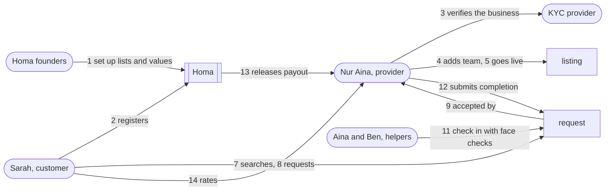
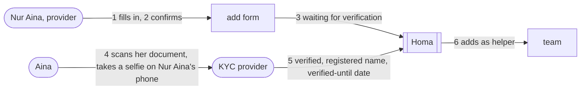
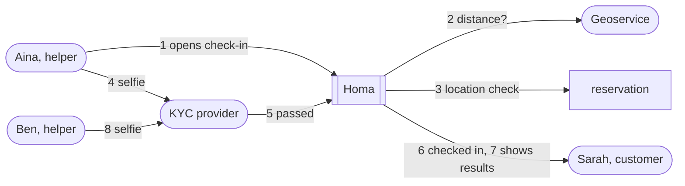

# Homa Domain Stories

> **Everyone deserves a well-cared home.**

These stories tell how Homa works, one business process at a time, the way the people involved would
tell it. They are written with **Domain Storytelling**: each story is a numbered sequence of sentences
of the form *actor – activity – work object – (to whom)*. Read in order, the sentences are the process.

Every provider on Homa is a business, and identity verification is done by a **KYC provider** (to be
chosen; Persona and Innov8tif are candidates). Homa's own work goes into value for homeowners and homecare
providers. The stories show the KYC provider as an actor, and Homa only using its results.

The stories describe Homa **as it is built**: the to-be process in the product description
(`docs/homa-product-description.md`) and the rules in the domain code. Each story ends with where it
lives in the code: the bounded contexts, the domain methods and the integration events. That way a
reader can go from a sentence to the rule that enforces it.

## Contents

- How to read the stories
- Actors
- Work objects
- Ubiquitous language
- The cast and the running example
- Big picture
- Stories
  - 1. Homa sets up the job list, the tool list and the Homa-set values
  - 2. A customer registers
  - 3. A business provider onboards
  - 4. A provider adds a helper or a supervisor
  - 5. A provider sets up the listing and goes live
  - 6. A provider manages availability
  - 7. A customer searches and browses
  - 8. A customer enquires in chat and reserves from it
  - 9. A customer requests a reservation directly
  - 10. The provider answers the request
  - 11. The customer cancels a reserved booking
  - 12. The provider cancels a reserved booking
  - 13. The provider names who is coming
  - 14. Job day: check-in with location and face checks
  - 15. The customer is not there: a customer no-show
  - 16. The job is completed and the provider is paid
  - 17. Something went wrong: a report and Homa's decision
  - 18. The customer rates the provider and the team
  - 19. Re-verification and ongoing monitoring
  - 20. Homa waives a fine
- Story map: where each story lives in the code
- Not told here

## How to read the stories

| Notation | Meaning |
|---|---|
| **Bold** | An **actor**: a person, a role, or a system that does something |
| *Italics* | A *work object*: the thing the actor works with, such as a *request* or a *face check* |
| `1.`, `2.`, … | The order of the activities. A sentence can start a branch, shown under **Variants** |
| "Homa" | The Homa platform acting on its own: checking a rule, sending a reminder, or running a scheduled step. When the founders act, the actor is **Homa founders** |
| A **bold** name inside a sentence, such as **request expiry time** | A Homa-set value from the product description. The launch value is shown next to it |

Each story has the same parts:
- **Goal**: why the story happens.
- **Story**: the numbered sentences.
- **Variants**: the other ways it can go.
- **Rules**: what the domain enforces.
- **In the code**: contexts, methods and integration events.

A story is **fine-grained** when it shows one process in detail, and **coarse-grained** when it shows
the whole journey; the big picture is coarse-grained, the rest are fine-grained.

## Actors

| Actor | Who they are |
|---|---|
| **Customer** | A homeowner who searches, reserves, pays, chats, reports and rates. Registers with a Malaysian phone number |
| **Provider** | A homecare business registered with SSM, acting through its owner or director. Every provider on Homa is a business |
| **Helper** | A team member who does the booked jobs. The customer books and pays for helpers. Has no account |
| **Supervisor** | A team member in charge on site. Not counted or charged as a helper. Has no account |
| **Homa** | The platform: applies the rules, sends reminders, and runs scheduled steps such as expiring requests and closing dispute windows |
| **Homa founders** | The people behind the admin console: they curate the lists and values, decide cases and waive fines |
| **KYC provider** (to be chosen; Persona and Innov8tif are candidates) | Runs every identity check on its own pages: the business's KYB with its owner's or director's KYC, each team member's KYC, re-verification, early re-checks, and face checks at the door. Reports a final result for each |

| **Stripe** | Authorises and charges cards, takes FPX payments, holds payments, pays out and refunds |
| **SMS provider** | Sends the customer's phone verification code |
| **Calendar service** | Google Calendar or Apple Calendar, synced into a provider's availability |
| **Geoservice** | Turns addresses into locations and measures the distance at check-in |

Homa's rules never depend on which KYC provider or payment provider is used.

## Work objects

| Work object | What it is | Context |
|---|---|---|
| *job list*, *tool list* | Homa's lists that providers choose from; retired items are never deleted | `catalogue` |
| *service area* | The launch cities: Salak Tinggi, Cyberjaya and Putrajaya | `catalogue` |
| *shelf* | A curated homepage row driven by a preset search | `catalogue` |
| *Homa-set values* | The values the policies use, in versions | `policy` |
| *phone verification* | A 6-digit SMS code, valid 5 minutes, 5 wrong attempts allowed | `account` |
| *customer account* | Name, phone number and address with its city | `account` |
| *provider account* | The business: verification status, SSM registration, verified-until date, payout account readiness | `account` |
| *KYB result*, *KYC result* | From the KYC provider: verified (with the SSM registration or the registered name, and the verified-until date) or rejected | `account` |
| *add form* | Role, profile photo and the lawful-employment confirmation for one person | `account` (`MemberVerification`) |
| *team member* | A verified helper or supervisor, with a registered name and a verified-until date | `account` |
| *verified-until date* | The date the KYC provider says a business or person is verified until; a job must end by the business's | `account` |
| *listing* | What a provider sells: jobs, tools, price, hours, helpers, cities, tier, team, supervisor rule | `offering` |
| *supervisor rule* | When a supervisor is sent: from a number of helpers, of hours, or both | `offering` |
| *calendar* | Availability windows, synced busy blocks, holds for accepted jobs, and a buffer | `availability` |
| *search* | Jobs, start, hours, helpers and city | `discovery` |
| *match list* | Exact matches, close matches, and why | `discovery` |
| *enquiry* | Booking details to chat about before requesting; has no payment | `reservation` |
| *chat* | One per enquiry or reservation | `conversation` |
| *request*, *reservation* | The reservation, from the request to its ending; called a request while it is Requested | `reservation` |
| *price* | Hours fee, travel fee, provider price, service fee and total | `reservation` |
| *payment* | A card authorisation or an upfront FPX payment, then held, released or refunded | `payment` |
| *team assignment* | The helpers and any supervisors named for a reservation | `reservation` |
| *location check*, *face check* | The two steps of check-in | `reservation` |
| *completion* | Photo or video evidence that the job is done | `reservation` |
| *report*, *case*, *decision* | A problem, Homa's queue entry for it, and the outcome | `reservation`, `resolution` |
| *settlement* | Who gets what of the total: provider, Homa and customer | `reservation` |
| *fine*, *payout* | A provider's fine, and a payout with fine deductions | `payment` |
| *rating*, *rating summary* | A customer's stars and feedback, and the averages shown | `feedback` |

## Ubiquitous language

These are the words Homa uses, in the spec, the stories, the code and the tests. Each term belongs to one
bounded context, which owns its meaning. **In the code** names the class, method or value that carries
it. **Don't say** lists the words that drift from it; use the term instead.

### Across Homa

| Term | Meaning | In the code | Don't say |
|---|---|---|---|
| **Homa** | The platform, acting on its own: applying a rule, reminding, or running a scheduled step | the usecases and domain methods | "the system", "the app" when Homa decides |
| **Homa founders** | The people who decide cases, waive fines, hide ratings, and set the lists and values | the `Homa…` usecases | "admin", "support" |
| **Customer** | A homeowner who books and pays | `CustomerAccount`, `Party.CUSTOMER` | "user", "client", "homeowner" in rules |
| **Provider** | A homecare business registered with SSM that sells its team's time. Every provider is a business | `ProviderAccount`, `Party.PROVIDER` | "vendor", "partner", "cleaner", "individual provider" |
| **Business** | The provider seen as a registered company: its SSM registration, KYB and payouts | `BusinessRegistration` | "company" in rules |
| **KYC provider** | The outside service that verifies identities, re-verifies, monitors, and runs face checks. Not named in the rules | the account and reservation ports | a vendor's name, "eKYC", "Kenal" |
| **Money** | An amount in ringgit, to the sen | `kernel.Money` | "price" for any amount |
| **Percentage** | A share, rounded half up to the sen when applied | `kernel.Percentage` | "rate" for a share |

### catalogue

| Term | Meaning | In the code | Don't say |
|---|---|---|---|
| **Job list** | Homa's list of jobs that providers choose from | `JobList` | "services", "menu" |
| **Job** | One kind of home care on the job list, such as kitchen care, in a **job group** | `Job`, `JobCode`, `JobGroup` | "task", "service" |
| **Tool list**, **tool** | Homa's list of tools that providers say they bring | `ToolList`, `Tool`, `ToolCode` | "equipment" |
| **Retire** | Take a job or tool off what providers can pick, and off the listings that have it; it is never deleted, and its code is never reused | `JobList.retire`, `ToolList.retire`, `ProviderListing.withdrawJob`, `withdrawTool` | "delete", "remove" |
| **Service area** | The launch cities: Salak Tinggi, Cyberjaya and Putrajaya | `ServiceArea`, `City` | "region", "zone" |
| **Shelf** | A curated homepage row driven by a **preset search** | `Shelf`, `PresetSearch` | "banner", "collection" |

### policy

| Term | Meaning | In the code | Don't say |
|---|---|---|---|
| **Homa-set values** | The values the policies use, set by Homa; each change is a new version for new reservations only | `HomaPolicy`, `PolicyValue`, `PolicySnapshot` | "settings", "config" |
| **Service fee** | 15% of the provider price, paid by the customer; how Homa earns | `ServiceFee` | "commission", "platform fee" |
| **Duration range** | 1 to 6 hours; each provider sets its own hours within it | `DurationRange` | "length" |
| **Minimum notice**, **booking horizon** | A start must be at least 2 hours from now and at most 30 days ahead | `MinimumNotice`, `BookingHorizon` | "lead time" |
| **Request expiry time** | 24 hours after the request, or the booked start if sooner | `RequestExpiry` | "timeout" |
| **Cancellation tier** | The provider's cancellation policy: **Flexible**, **Standard** or **Firm** | `CancellationTier` | "plan", "cancellation level" |
| **Fee window** | The 24 hours before the booked start, when Standard and Firm charge a fee | `FeeWindow` | "late period" |
| **Late cancellation fine**, **no-show fine** | The provider's fines: 20% and 30% of the hours fee | `ProviderLateCancellationFine`, `ProviderNoShowFine` | "penalty" |
| **Fine deduction cap** | At most 50% of a payout goes to fines | `FineDeductionCap` | "limit" |
| **Team reminder time** | 6 hours before the start, while the team is not named | `TeamReminder` | — |
| **Earliest check-in**, **check-in period** | Check-in opens 15 minutes before the start and closes 15 minutes after it | `EarliestCheckIn`, `CheckInPeriod` | "grace period" |
| **Check-in radius** | 300 metres from the customer's location | `CheckInRadius` | "geofence" |
| **Customer no-show wait**, **customer no-show fee**, **no-show report window** | 15 minutes; travel fee + 30% of the hours fee; 1 hour to challenge | `CustomerNoShowWait`, `CustomerNoShowFee`, `NoShowReportWindow` | — |
| **Completion reminder time**, **completion deadline** | 30 minutes and 24 hours after the booked end | `CompletionReminder`, `CompletionDeadline` | — |
| **Dispute window extension**, **evidence retention period** | 1 hour after the later of the end and completion; evidence kept 7 days after resolution | `DisputeWindowExtension`, `EvidenceRetention` | — |
| **Rating window**, **minimum ratings to show** | 14 days to rate; 3 ratings before an average shows | `RatingWindow`, `MinimumRatingsToShow` | — |

### account

| Term | Meaning | In the code | Don't say |
|---|---|---|---|
| **Customer account** | Name, Malaysian mobile number and address with its city | `CustomerAccount`, `Address` | "profile" |
| **Phone verification** | A 6-digit SMS code, valid 5 minutes, 5 wrong attempts allowed | `PhoneVerification` | "OTP check" in rules |
| **KYB** | The KYC provider's verification of a business's SSM registration, with its owner's or director's KYC in the same flow | `KybResult`, `recordKybResult` | "eKYB", "business check by Homa" |
| **KYC** | The KYC provider's verification of a person's identity: document and live selfie | `KycResult`, `recordKycResult` | "eKYC" |
| **Verified**, **rejected** | A result from the KYC provider; nothing else is a result | `VerificationStatus.VERIFIED`, `REJECTED` | "approved", "failed" |
| **Verified-until date** | The date a business or person is verified until, from the KYC provider; a job must end by the business's | `verifiedUntil()` | "expiry date", "due date" |
| **Re-verification** | Verifying again: businesses every year, team members every year and when their document expires | `recordKybResult`, `recordKycResult` returning `REVERIFIED` | "renewal", "re-check" for the regular one |
| **Re-verification required** | Monitoring asks for re-verification by a date; the business or person keeps working, and the verified-until date moves sooner | `requireReverification` | "warning", "soft lapse" |
| **Lapse**, **lapsed** | A missed re-verification, reported by the KYC provider: a business is paused, a team member leaves the team, until they pass | `lapse()`, `VerificationStatus.LAPSED`, `TeamStatus.LAPSED` | "expired", "suspended", "deactivated" |
| **Serious flag** | A confirmed red-code finding from monitoring, such as struck off or a sanctions match: the business lapses at once | `recordSeriousFlag`, `seriousFlag()` | "warning", "suspension" |
| **Early re-check** | Homa asks the KYC provider to re-verify sooner, with a reason | the `HomaRequestEarlyRecheck` usecase | "audit" |
| **Verification outcome** | What a result did: `VERIFIED`, `REJECTED`, `REVERIFIED`, `RECHECK_FAILED` or `UNCHANGED` | `VerificationOutcome` | — |
| **Team** | Everyone verified to work for a provider | the team members of one provider | "staff", "crew", "employees" |
| **Team member** | A verified helper or supervisor on a provider's team; has no account | `TeamMember`, `TeamStatus.MEMBER` | "staff", "worker", or "helper" when it could be a supervisor |
| **Helper** | A team member who does the booked jobs; the customer books and pays for helpers | `TeamRole.HELPER` | "cleaner", "maid" |
| **Supervisor** | A team member in charge on site; not counted or charged as a helper | `TeamRole.SUPERVISOR` | "lead", "manager" |
| **Add form** | What the provider fills in to add a team member: role, profile photo and the lawful-employment confirmation | `MemberVerification.start` | "invite" |
| **Waiting for verification** | Added on the form, not yet verified: not on the team | `MemberVerificationStatus.WAITING` | "invited", "pending member" |
| **Lawful-employment confirmation** | The provider's confirmation, for one person, that they are lawfully employed or engaged and allowed to work in Malaysia | `EmploymentConfirmation` | "work permit check" |
| **Registered name** | The name on a person's identity document, from the KYC result; nobody types it | `registeredName()` | "display name", "nickname" |
| **Remove** | The provider or Homa takes a team member off; they cannot come back | `TeamMember.remove` | "fire", "delete" |
| **Payout account** | The business bank account Stripe pays out to | `recordPayoutAccountReady` | "wallet" |

### offering

| Term | Meaning | In the code | Don't say |
|---|---|---|---|
| **Listing** | What a provider sells: profile, jobs, tools, pricing, hours, helpers, cities, tier, team and supervisor rule | `ProviderListing` | "shop", "store", "profile" for the whole |
| **Profile** | The listing's display name and picture | `Profile` | — |
| **Draft**, **live** | A listing being set up, and one customers can find and request | `isLive()`, `goLive` | "published", "active" |
| **Go-live requirement** | Something still missing before going live, listed for the provider | `GoLiveRequirement` | — |
| **Go offline** | A live listing stops being live, for example with no helper left | `updateRoster` | "unpublish" |
| **Paused** | Live, but taking no new requests, because the business lapsed or was flagged | `pause`, `isPaused`, `takesRequests` | "suspended", "hidden" |
| **Hourly rate** | The flat rate per helper per hour | `HourlyRate` | "price" |
| **Travel fee** | A **separate** flat fee, or **included** in the price | `TravelFee` | "transport fee", "call-out fee" |
| **Hours range**, **helpers range** | The provider's own minimum and maximum hours and helpers per booking | `HoursRange`, `HelpersRange` | — |
| **Team roster** | The provider's team members by role, as the listing knows them: helpers and supervisors | `TeamRoster` | "team list" |
| **Supervisor rule** | When a supervisor is sent: from a number of helpers, of hours, or both | `SupervisorRule` | "supervisor threshold" in code |
| **Offering snapshot** | What a reservation copies from the listing at request time | `OfferingSnapshot` | — |

### availability

| Term | Meaning | In the code | Don't say |
|---|---|---|---|
| **Calendar** | A provider's availability windows, synced busy blocks, holds and buffer | `ProviderCalendar` | "schedule" |
| **Availability window** | A stretch when the provider can work | `AvailabilityWindow` | "opening hours" |
| **Busy block** | A synced calendar event | `BusyBlock` | "appointment" |
| **Hold** | An accepted reservation's slot in the calendar | `ReservationHold`, `hold`, `release` | "lock" |
| **Buffer between jobs** | Time kept free before and after each accepted job | `setBufferBetweenJobs` | "gap" |

### discovery

| Term | Meaning | In the code | Don't say |
|---|---|---|---|
| **Search** | Jobs, start, hours, helpers and city | `SearchCriteria` | "query", "filter" |
| **Exact match** | Covers the city, offers every job, fits the helpers and hours, and is free at the chosen time | `Match.EXACT` | "perfect match" |
| **Close match** | Offers some of the jobs, or is free within 2 hours either side | `Match.CLOSE`, `NEAR_THE_CHOSEN_TIME` | "partial match", "similar" |
| **No match** | Fails a rule, with its **match reason** | `Match.NONE`, `MatchReason` | — |

### reservation

| Term | Meaning | In the code | Don't say |
|---|---|---|---|
| **Enquiry** | Booking details to chat about before requesting; no payment and not a status | `Enquiry` | "draft booking", "quote" |
| **Reservation** | A booking from the customer's request to its ending | `Reservation` | "order", "appointment" |
| **Request** | A reservation while it is **Requested**, waiting for the provider | `Reservation.request`, `ReservationStatus.REQUESTED` | "booking request" |
| **Booking**, **booked** | What the customer chose: jobs, start, hours, helpers and address; the *booked start* and *booked end* | `ReservationDetails` | — |
| **Reservation status** | Requested, Reserved, Declined, Expired, Cancelled, Disputed or Completed | `ReservationStatus` | "state" for these |
| **Hours fee** | Hourly rate per helper × helpers × hours; supervisors aren't charged | `PriceBreakdown.hoursFee` | "labour cost" |
| **Provider price** | The hours fee plus a separate travel fee | `PriceBreakdown.providerPrice` | "subtotal" |
| **Total** | Provider price plus service fee: what the customer pays | `PriceBreakdown.total` | "price" alone |
| **Cancellation terms** | What cancelling costs, and from when, as the review page shows it | `cancellationTerms()` | — |
| **Team assignment** | The helpers and any supervisors named for a reservation | `TeamAssignment`, `nameTeam` | "crew", "lead" |
| **Location check** | The first step of check-in: the device within the check-in radius | `checkIn`, `CheckIn` | "check-in" alone |
| **Face check** | A named person's live selfie matched by the KYC provider; one final result each, **passed** or **failed** | `recordFaceCheck`, `FaceCheck`, `FaceCheckResult` | "selfie check", "attempt" |
| **Checked in** | Check-in complete: the location check and the first face pass, or a face check outage | `isCheckedIn`, `checkedInAt` | "arrived" |
| **Can work** | A named person who passed their face check, or covered by an outage | `canWork` | — |
| **Provider no-show** | No check-in by the end of the check-in period | `markProviderNoShow`, `Ending.PROVIDER_NO_SHOW` | — |
| **Customer no-show** | The customer isn't there after the wait; the provider earns the customer no-show fee | `reportCustomerNoShow`, `Ending.CUSTOMER_NO_SHOW` | — |
| **Challenge** | The customer reports a wrongful customer no-show | `challengeNoShow` | "appeal" |
| **Completion** | The provider's photo or video evidence that the job is done | `submitCompletion`, `Completion`, `EvidenceRef` | "done", "finished" as a status |
| **Dispute window** | From the booked start to the extension after the later of the end and completion | `disputeWindowEndsAt`, `closeDisputeWindow` | "review period" |
| **Report** | One party's problem: **during the job** or **with the finished work** | `fileReport`, `Report`, `ReportType` | "complaint", "ticket" |
| **Settlement** | Who gets what of the total: provider earning, service fee, customer refund | `Settlement` | "payout" |
| **Ending** | Why a reservation ended, which decides the settlement | `Ending` | — |
| **Fine charge** | A fine the reservation raises: late cancellation or no-show | `FineCharge`, `FineReason` | "penalty" |
| **Verified for the whole job** | A job must end by the business's verified-until date, at request, edit and acceptance | `request`, `edit`, `accept` with `providerVerifiedUntil` | — |
| **Flagged reservation** | An accepted reservation of a seriously flagged business: Disputed, then cancelled with a full refund, or restored if cleared before the start | `disputeForProviderFlag`, `cancelForProviderFlag`, `restoreAfterFlagCleared`, `Ending.PROVIDER_FLAGGED` | "suspended booking" |

### payment

| Term | Meaning | In the code | Don't say |
|---|---|---|---|
| **Payment** | The customer's money for a reservation, by card or FPX | `Payment`, `PaymentMethod` | "transaction" |
| **Authorised**, **authorisation released** | A card checked and nothing charged; let go when the request ends before acceptance | `PaymentState.AUTHORISED`, `AUTHORISATION_RELEASED` | "pre-charge" |
| **Held**, **released**, **refunded** | Paid and held by Homa; paid to the provider; returned to the customer | `PaymentState.HELD`, `RELEASED`, `REFUNDED` | "escrow" |
| **Capture** | Charging an authorised card when the provider accepts | `capture` | — |
| **Payout** | What one reservation pays the provider, less fines deducted | `Payout`, `PayoutKind` | "settlement" |
| **Fine** | A provider's fine, deducted from later payouts for completed jobs | `Fine`, `FineDeductionPolicy` | "penalty" |
| **Waive** | Homa clears what is left of a fine, with a reason, once | `Fine.waive` | "forgive", "cancel a fine" |
| **Held payout**, **withheld** | A flagged business's payout waiting for the founders, and one they kept back | `PayoutStatus.HELD`, `WITHHELD`, `hold`, `releaseHold`, `withhold` | "frozen" |

### resolution

| Term | Meaning | In the code | Don't say |
|---|---|---|---|
| **Case** | One entry in the founders' queue for a reservation, with its evidence | `Case`, `CaseSource` | "ticket" |
| **Decision** | **Release**, **partial refund** or **full refund**, with a short reason | `Decision`, `Case.decide` | "verdict", "ruling" |
| **At stake** | The most the provider can receive: the provider price, or the no-show fee for a challenge | `atStake()` | — |

### conversation

| Term | Meaning | In the code | Don't say |
|---|---|---|---|
| **Chat** | The messages for one enquiry or reservation; only the customer starts one | `Conversation`, `ChatSubject` | "thread", "inbox" for one chat |
| **Archive** | A closed enquiry's chat, still readable | `archive` | "delete" |

### feedback

| Term | Meaning | In the code | Don't say |
|---|---|---|---|
| **Rating** | A customer's stars for a Completed reservation, once | `Rating` | "review" |
| **Overall stars**, **category stars** | 1 to 5 stars; overall is required, categories optional | `Stars`, `ProviderCategory`, `HelperCategory` | "score" |
| **Provider rating** | Overall stars, provider categories and optional written feedback | `ProviderRating` | — |
| **Helper rating** | Overall stars and helper categories for one named team member, helper or supervisor; no written feedback | `HelperRating` | "staff review" |
| **Rating summary** | The averages shown once there are enough ratings | `RatingSummary` | "score card" |
| **Hide** | Homa takes a rating that breaks the rules out of the averages, with a reason; never edited | `Rating.hide` | "delete", "edit" |

### Words to avoid

- **"eKYC", "eKYB", "Kenal":** say **KYC**, **KYB** and **the KYC provider**. The provider is still to be
  chosen, and the rules don't depend on it.
- **"Independent provider":** every provider is a business.
- **"Invite", "invited helper":** a person is added on the **add form** and is **waiting for
  verification** until the KYC provider verifies them.
- **"Lead":** the person in charge on site is a **supervisor**.
- **"Helper" for anyone on the team:** say **team member** when it could be a supervisor.
- **"Check-in" for the location step alone:** say **location check**; **checked in** means complete.
- **"Expired" for a verification:** say **lapsed**. "Expired" is a request's status.
- **"Suspended":** say **paused** for a listing, **lapsed** for verification. Suspension is not in the MVP.
- **"Due date" for verification:** say **verified-until date**.

## The cast and the running example

The stories follow one booking from start to end.

| Who | In the stories |
|---|---|
| **Sarah** | A customer in Cyberjaya |
| **Kemas Home Care** | A provider: **Kemas Home Care Sdn Bhd**, a business registered with SSM, run by its director **Nur Aina** |
| **Aina** and **Ben** | Helpers on the Kemas team |
| **Chan** | A third helper |
| **Siti** | A supervisor on the Kemas team |

The booking: **kitchen care and laundry folding, Saturday 10:00, 3 hours, 2 helpers, in Cyberjaya.**
Kemas charges RM30 per helper per hour, with a separate RM20 travel fee, on the **Standard**
cancellation tier.

| Price part | Amount |
|---|---|
| Hours fee: RM30 × 2 helpers × 3 hours | RM180.00 |
| Travel fee | RM20.00 |
| **Provider price** | **RM200.00** |
| Service fee: 15% of the provider price | RM30.00 |
| **Total Sarah pays** | **RM230.00** |

## Big picture

The whole journey, coarse-grained. Each step is told in detail by the story in brackets.

1. **Homa founders** set up the *job list*, the *tool list* and the *Homa-set values*. (1)
2. **Sarah** registers a *customer account* with her phone number. (2)
3. **Nur Aina** registers *Kemas Home Care Sdn Bhd* and verifies it through KYB with the **KYC provider**. (3)
4. **Nur Aina** adds *Aina*, *Ben* and *Siti* to the team; each verifies on the spot. (4)
5. **Nur Aina** sets up the *listing* and takes it live. (5)
6. **Nur Aina** keeps the *calendar* up to date. (6)
7. **Sarah** searches and finds *Kemas* in the *match list*. (7)
8. **Sarah** chats in an *enquiry*, or requests directly, and pays by card or FPX. (8, 9)
9. **Nur Aina** accepts the *request*. (10)
10. **Nur Aina** names *Aina* and *Ben* for the job. (13)
11. On Saturday, **the team** checks in: the *location check*, then each person's *face check*. (14)
12. **The team** does the job, and **Nur Aina** submits the *completion* evidence. (16)
13. **Homa** closes the *dispute window* and releases the *payout* to Kemas. (16)
14. **Sarah** rates *Kemas*, *Aina* and *Ben*. (18)
15. The **KYC provider** re-verifies **Kemas** and its team every year, and monitors them in between. (19)

What can go wrong along the way: cancellations (11, 12), a customer no-show (15), a report and a
decision (17), and a waived fine (20).

## Stories

### 1. Homa sets up the job list, the tool list and the Homa-set values

**Goal:** every provider chooses from the same lists, so search can match jobs exactly, and every
reservation runs on known values.

1. **Homa founders** add *jobs* to the *job list*, each in a group such as "kitchen" or "living room".
2. **Homa founders** add *tools* to the *tool list*.
3. **Homa founders** create *shelves* for the homepage, each with a preset search.
4. **Homa founders** launch *Homa-set values* version 1.
5. Later, **Homa founders** change one *Homa-set value*, such as the **fee window**.
6. **Homa** keeps the old version for every reservation already requested, and applies the new
   version to new reservations only.

**Variants**
- 1a. **Homa founders** rename or retire a *job*. A retired job stays in the list, is never deleted,
  and its code is never reused. Providers can no longer pick it.
- 1b. **Homa** takes a retired *job* or *tool* off every *listing* that has it. A live listing left
  with no job goes offline until the provider offers another. Requests already made keep the job.
- 5a. **Homa** refuses a change that breaks a rule across values: Flexible must stay free, no
  cancellation fee may be higher than the customer no-show fee, and the provider no-show fine must stay
  the highest fine.

**Rules**
- The launch values include: service fee 15%; 1 to 6 hours; minimum notice 2 hours; booking horizon
  30 days; request expiry 24 hours; fee window 24 hours; tiers 0%, 10% and 20%; provider fines 20% and
  30%; fine deduction cap 50%; team reminder 6 hours; earliest check-in and check-in period 15 minutes;
  check-in radius 300 metres; customer no-show wait 15 minutes; no-show fee travel + 30%; no-show
  report window 1 hour; completion reminder 30 minutes; completion deadline 24 hours; dispute window
  extension 1 hour; evidence retention 7 days; rating window 14 days; and minimum ratings to show 3.
- The verification rules (accepted documents, yearly re-verification, ongoing monitoring, early
  re-checks, face check attempts) are the KYC provider's, set up to Homa's requirements.
- Homa sets no limit on helpers.

**In the code:** `catalogue` (`JobList.add`, `rename`, `retire`; `ToolList`; `Shelf.create`), `policy`
(`HomaPolicy.initial`, `HomaPolicy.change`), `offering` (`ProviderListing.withdrawJob`,
`withdrawTool`). Events: `JobAddedIE`, `JobRetiredIE`, `ToolAddedIE`, `ToolRetiredIE`,
`ServiceAreaPublishedIE`, `HomaPolicyChangedIE`.

### 2. A customer registers

**Goal:** Sarah can sign in, providers see who the booking is for, and Homa knows her city.

1. **Sarah** enters her *phone number* in the Homa app.
2. **Homa** asks the **SMS provider** to send a 6-digit *verification code* to Sarah.
3. **Sarah** enters the *code*.
4. **Homa** confirms the *phone verification*.
5. **Sarah** enters her *name* and *address*.
6. **Homa** asks the **geoservice** for the address's *location* and *city*.
7. **Homa** registers Sarah's *customer account*.

**Variants**
- 3a. The *code* is wrong: **Homa** refuses it. After 5 wrong codes, Sarah asks for a new one.
- 3b. The *code* has expired after 5 minutes: **Homa** refuses it.
- 7a. **Sarah** later changes her *address*.

**Rules:** a Malaysian mobile number; registration only with a confirmed phone.

**In the code:** `account` (`PhoneVerification.start`, `confirm`; `CustomerAccount.register`,
`changeAddress`). Event: `CustomerRegisteredIE`.

### 3. A business provider onboards

**Goal:** Kemas Home Care Sdn Bhd sells its team's time on Homa.

1. **Nur Aina** registers a *provider account* for Kemas with a confirmed phone number.
2. **Nur Aina** opens the **KYC provider**'s *KYB* pages from the provider app.
3. The **KYC provider** checks Kemas's *SSM registration*.
4. **Nur Aina**, as director, completes her *KYC* in the same flow: she scans her MyKad and takes a live
   selfie.
5. The **KYC provider** reports a *verified result* with the *SSM number*, the *registered business
   name* and the *verified-until date* (1 April).
6. **Homa** records the result. Homa does no check of its own.
7. **Homa** starts Kemas with **no team members**.
8. **Nur Aina** adds a *payout account* (a business bank account) with **Stripe**, and **Stripe**
   reports it ready.

**Variants**
- 5a. The **KYC provider** reports a *rejected result*: Kemas redoes KYB, and can pass on a later
  attempt.
- 7a. Nur Aina works on site too: she adds herself as a *team member*, like anyone else (story 4).

**Rules**
- The director must be Malaysian, with a MyKad or a Malaysian passport. That is the KYC provider's rule,
  set up to Homa's requirement.
- A business is ready to go live once verified, not lapsed, and with a ready payout account.
- The provider page shows the profile's display name and "Business · SSM registered". The registered
  business name is kept for Homa's records.

**In the code:** `account` (`ProviderAccount.register`, `recordKybResult`, `recordPayoutAccountReady`,
`isReadyForGoLive`; `KybResult`, `BusinessRegistration`). Events: `ProviderVerifiedIE`,
`ProviderVerificationRejectedIE`, `PayoutAccountReadyIE`.

### 4. A provider adds a helper or a supervisor

**Goal:** only verified people enter a customer's home. Aina joins the Kemas team as a helper.

1. **Nur Aina** fills in the *add form* in the provider app: the role **helper** and Aina's *profile
   photo*.
2. **Nur Aina** ticks the *lawful-employment confirmation*: Aina is lawfully employed by or engaged with
   Kemas and allowed to work in Malaysia, and Kemas is responsible for it.
3. **Homa** records the *confirmation* with its time and the version of the terms, and shows Aina as
   *waiting for verification*.
4. **Aina**, with Nur Aina, completes the **KYC provider**'s check on Nur Aina's phone: she scans her own
   identity document and takes her own live *selfie*.
5. The **KYC provider** reports a *verified result* with the *registered name* "Aina binti Ahmad" and
   the *verified-until date*.
6. **Homa** adds Aina to the *team* as a *helper*.

**Variants**
- 2a. **Nur Aina** does not tick the confirmation: the form cannot be sent.
- 5a. The **KYC provider** reports a *rejected result*, or its session times out or is abandoned:
  nothing is added, and **Nur Aina** starts again with a new form.
- 6a. **Nur Aina** adds **Siti** the same way, with the role **supervisor**.
- 6b. Later, **Nur Aina** removes a *team member*, or **Homa founders** remove one who is not allowed to
  work. A removed person cannot come back.

**Rules**
- Which documents are accepted, and how the face is matched, are the KYC provider's rules. Team members
  can be Malaysian or foreign.
- Homa sets no time limit; the KYC provider ends an unfinished session.
- A waiting person is not on the team, not shown to customers, and cannot be named for jobs.
- Teams have no size limit.

**In the code:** `account` (`MemberVerification.start`, `recordKycResult`; `TeamMember.add`,
`remove`). Events: `MemberVerificationStartedIE`, `MemberVerificationRejectedIE`, `TeamMemberAddedIE`,
`TeamMemberRemovedIE`.

### 5. A provider sets up the listing and goes live

**Goal:** Kemas appears in search and can take requests.

1. **Nur Aina** drafts a *listing* for Kemas.
2. **Nur Aina** sets the *profile*: the display name "Kemas Home Care" and a picture.
3. **Nur Aina** chooses *jobs* from Homa's *job list* (kitchen care, laundry folding) and *tools* from
   the *tool list* (a steam mop).
4. **Nur Aina** sets the *pricing*: RM30 per helper per hour and a separate RM20 travel fee.
5. **Nur Aina** sets the *hours*, 2 to 4, within Homa's 1 to 6.
6. **Nur Aina** sets the *helpers range*, 1 to 3, at most the helpers on her team.
7. **Nur Aina** sets the *supervisor rule*: a supervisor comes from 3 helpers or from 4 hours.
8. **Nur Aina** chooses the *cities* she covers (Cyberjaya) and the *Standard* cancellation tier.
9. **Nur Aina** takes the *listing* live.
10. **Homa** checks the *listing* and Nur Aina's *provider account*, and makes the listing live.

**Variants**
- 10a. Something is missing: **Homa** lists everything still missing, such as the profile picture or
  the cities, and the listing stays a draft.
- 7a. Kemas has no supervisor on the team: **Homa** refuses the supervisor rule.
- 6a. A helper leaves the team: **Homa** shrinks the *helpers range* to the helpers left. With no helper
  left, or with a supervisor rule and no supervisor left, **Homa** takes the listing offline.
- 10b. **Nur Aina** changes the *listing* later: the change applies to new requests only.

**Rules**
- Go-live needs a complete listing; a verified, not lapsed business with a ready payout account; enough
  helpers; and a supervisor when a rule is set.
- People still waiting for verification never block going live. Supervisors never count towards the
  helpers range, and are not charged.

**In the code:** `offering` (`ProviderListing.draft`, `setProfile`, `offerJobs`, `bringTools`,
`setPricing`, `setHours`, `setHelpers`, `setSupervisorRule`, `coverCities`, `chooseCancellationTier`,
`updateRoster`, `goLive`, `missingForGoLive`). Events: `ListingWentLiveIE`, `ListingChangedIE`,
`ListingWentOfflineIE`.

### 6. A provider manages availability

**Goal:** search shows Kemas only when the team can actually work.

1. **Nur Aina** sets *availability windows* in her *calendar*.
2. **Nur Aina** connects her **calendar service**.
3. The **calendar service** syncs her events into the *calendar* as *busy blocks*.
4. **Nur Aina** sets a *buffer* of 30 minutes between jobs, for travel.
5. When a request is accepted, **Homa** holds the *slot* in the *calendar*.
6. When an accepted job is cancelled, **Homa** releases the *slot*.

**Variants**
- 5a. A slot overlaps another hold, or falls inside the buffer around one: **Homa** refuses to hold it.

**Rules**
- A slot is free when it is inside a window, with no busy block or hold over it.
- Back-to-back windows count as one stretch, and an event ending exactly at a slot's start does not
  block it.
- The buffer applies around Homa jobs only, not synced events, and changing it does not affect jobs
  already accepted.

**In the code:** `availability` (`ProviderCalendar.setWindows`, `replaceBusyBlocks`,
`setBufferBetweenJobs`, `hold`, `release`, `isAvailable`, `nearestAvailableStart`). It listens to
`ReservationAcceptedIE` and `ReservationCancelledIE`.

### 7. A customer searches and browses

**Goal:** Sarah finds a provider for Saturday.

1. **Sarah** picks the *jobs* (kitchen care, laundry folding), a *start* (Saturday 10:00), the *hours*
   (3) and the *helpers* (2).
2. **Homa** checks the *search*: at least 1 helper, 1 to 6 hours, a quarter-hour start between 2 hours
   and 30 days ahead.
3. **Homa** asks each provider's *calendar* whether they are free, or free near the time.
4. **Homa** sorts providers in Sarah's city into a *match list*: exact matches and close matches.
5. **Sarah** opens the *provider page* for Kemas: jobs, tools it brings and doesn't, price, cancellation
   policy in words, provider type, team (registered names, roles, photos, average stars), when a
   supervisor is included, ratings, and the Verified ID badge.

**Variants**
- 4a. A **close match** offers only some of the jobs, or is free for the same duration at a start up to
  2 hours before or after.
- 4b. A provider is **no match** when they don't cover the city, the helpers or hours are outside their
  range, they offer none of the jobs, they aren't free at or near the time, or the job would end after
  their verified-until date.
- 4c. A *paused* listing is left out of search.
- 1a. **Sarah** starts from a homepage *shelf* instead, with its preset search.
- 4d. **Homa** records each *search*: what was searched for and how many providers matched, with
  nothing about Sarah, so the founders can see where more providers are needed.

**In the code:** `discovery` (`SearchCriteria.of`, `MatchClassifier.classify`, `ProviderCandidate`),
with `availability` answering free times. It keeps listings from the listing events,
`HomaPolicyChangedIE`, and businesses' verified-until dates from `ProviderVerifiedIE` and
`ProviderReverifiedIE`.

### 8. A customer enquires in chat and reserves from it

**Goal:** Sarah asks Kemas a question before she commits.

1. **Sarah** picks the booking details on the Kemas page and taps **Chat**.
2. **Homa** creates an *enquiry* with its own *chat*. The enquiry has no payment.
3. **Sarah** asks in the *chat* whether Kemas brings a vacuum.
4. **Nur Aina** replies in the *chat*.
5. **Sarah** taps **Reserve** in the *chat*.
6. **Homa** opens the *review page*, filled in with the enquiry details.
7. **Sarah** edits the details if needed, and submits the *request* (story 9).
8. **Homa** links the *chat* to the new *reservation*; the same chat carries on.

**Variants**
- 7a. **Sarah** never requests: **Homa** closes the *enquiry* when its date passes, and archives the
  *chat*, which stays readable.
- 1a. **Sarah** books again from a past *chat*: **Homa** creates a new *enquiry* with the same details at
  a new start.

**Rules:** only the customer starts a chat; the provider replies. Enquiry details are edited only on
the review page. Every chat reminds both sides that payments and messages outside Homa are not covered.

**In the code:** `reservation` (`Enquiry.create`, `bookAgainFrom`, `isClosed`, `markRequested`),
`conversation` (`Conversation.startByCustomer`, `post`, `linkReservation`, `archive`). Events:
`EnquiryCreatedIE`, `EnquiryRequestedIE`, `EnquiryClosedIE`.

### 9. A customer requests a reservation directly

**Goal:** Sarah books Kemas for Saturday.

1. **Sarah** checks the *review page*: the *price* (RM230.00 in total) and the *cancellation terms*
   ("Cancel after Fri 10:00 am: you pay RM18. Before that: free").
2. **Sarah** taps **Reserve** and pays by **card**.
3. **Stripe** authorises RM230.00 on Sarah's card. Nothing is charged yet.
4. **Homa** creates the *request*, in **Requested**, keeping the *offering* and the *Homa-set values*
   in force now.
5. **Homa** notifies **Nur Aina** of the *request*.

**Variants**
- 2a. **Sarah** pays by **FPX**: **Stripe** takes RM230.00 upfront, and Homa holds it.
- 3a. **Stripe** reports that the *payment* failed: the card was declined, or the FPX payment failed or
  was abandoned. **Homa** ends the *request* straight away, as **Cancelled**, and tells **Sarah**.
  Nothing is charged.
- 4a. **Homa** refuses the request when: the start is not on a quarter hour, is under 2 hours away or
  beyond 30 days; the hours or helpers are outside Kemas's range; a job isn't offered; the city isn't
  covered; the listing is paused; or the job would end after Kemas's verified-until date.
- 6. **Sarah** edits the *request* before it is accepted: the card authorisation is updated to the new
  total, or for FPX she pays the increase or is refunded the decrease. The expiry still runs from the
  first request.
- 7. **Sarah** cancels the *request* before Kemas answers: it is free, the authorisation is released or
  the FPX payment refunded in full.

**In the code:** `reservation` (`Reservation.request`, `price`, `cancellationTerms`, `edit`,
`cancelByCustomer`, `paymentFailed`), `payment` (`Payment.authoriseCard`, `payUpfrontByFpx`,
`adjustTotal`, `cancelBeforeAcceptance`). Events: `ReservationRequestedIE`, `ReservationEditedIE`,
`RequestCancelledIE`, `PaymentFailedIE`.

### 10. The provider answers the request

**Goal:** Kemas confirms Sarah's request.

1. **Nur Aina** opens the *request*.
2. **Nur Aina** accepts it.
3. **Homa** checks that the request has not expired, that the listing is not paused, and that the job
   ends by Kemas's verified-until date as it is now.
4. **Homa** makes the *reservation* **Reserved**.
5. **Stripe** charges Sarah's card the RM230.00 and Homa holds it.
6. **Homa** holds the *slot* in Kemas's *calendar*.

**Variants**
- 2a. **Nur Aina** declines: the reservation is **Declined**, and the authorisation is released or the
  FPX payment refunded in full.
- 2b. **Nur Aina** doesn't answer: at the **request expiry time** (24 hours after the request, or the
  booked start if sooner), **Homa** expires it with a full release or refund.
- 3a. Kemas's listing is paused because its re-verification lapsed: Nur Aina cannot accept. The request
  stays Requested and expires normally, unless Kemas re-verifies in time.
- 3b. Kemas's verified-until date is before the job ends: Nur Aina can accept only after the **KYC
  provider** re-verifies Kemas and the date moves out.

**In the code:** `reservation` (`Reservation.accept`, `decline`, `expire`), `payment`
(`Payment.capture`, `cancelBeforeAcceptance`), `availability` (`hold`). Events:
`ReservationAcceptedIE`, `ReservationDeclinedIE`, `ReservationExpiredIE`, `PaymentCapturedIE`,
`PaymentRefundedIE`. The paused-listing check is required usecase rule R2.

### 11. The customer cancels a reserved booking

**Goal:** Sarah's plans changed.

1. **Sarah** cancels the *reservation* on Thursday.
2. **Homa** applies Kemas's *cancellation tier*: before the **fee window** opens (24 hours before the
   start), it is free.
3. **Homa** settles the *payment*: a full refund of RM230.00.
4. **Homa** releases the *slot* in Kemas's *calendar*.

**Variants**
- 1a. **Sarah** cancels on Friday at 11:00, inside the fee window: on Standard, Kemas receives 10% of
  the hours fee, RM18.00, released straight away; the travel fee is refunded, and the service fee
  follows what Kemas receives.
- 1b. On **Flexible**, cancelling before the start is always free. On **Firm**, the fee is 20% of the
  hours fee.
- 1c. With the travel fee included in the price, the percentage applies to the full provider price.
- 1d. **Sarah** tries to cancel during the check-in period before check-in: **Homa** refuses until the
  team checks in or the period ends.
- 1e. **Sarah** cancels after the team checked in: it counts as a customer no-show (story 15).

**In the code:** `reservation` (`Reservation.cancelByCustomer`, `cancellationTerms`), `payment`
(`Payment.settle`). Events: `ReservationCancelledIE`, `SettlementDecidedIE`, `PaymentRefundedIE`.

### 12. The provider cancels a reserved booking

**Goal:** Kemas cannot do the job.

1. **Nur Aina** cancels the *reservation*.
2. **Homa** refunds Sarah in full: RM230.00.
3. **Homa** works out Kemas's *fine* from the timing alone.
4. **Homa** records the *fine*, to be deducted from Kemas's next payouts (story 16).

**Variants**
- 3a. More than 24 hours before the start: no fine.
- 3b. Within 24 hours before the start: a *late cancellation fine* of 20% of the hours fee, RM36.00.
- 3c. After the booked start, or after checking in: a *no-show fine* of 30%, RM54.00, the highest fine.
- 3d. The fine is the same on every tier. With travel included, the percentage applies to the provider
  price.

**In the code:** `reservation` (`Reservation.cancelByProvider` returns the settlement and the fine
charge), `payment` (`Fine.charge`). Events: `ReservationCancelledIE`, `SettlementDecidedIE`,
`FineChargedIE`.

### 13. The provider names who is coming

**Goal:** Sarah knows who will enter her home before they arrive.

1. At the **team reminder time** (6 hours before the start), **Homa** reminds **Nur Aina** to name the
   team, if she hasn't yet.
2. **Nur Aina** names *Aina* and *Ben* as the *helpers* for the reservation.
3. **Homa** checks the *team assignment* against the *team*.
4. **Homa** shows **Sarah** each person's registered name, role, photo and average stars.

**Variants**
- 3a. The number of helpers named doesn't match the 2 booked: **Homa** refuses.
- 3b. A helper isn't a helper on the team, or a supervisor isn't a supervisor on it: **Homa** refuses.
- 3c. The booking reaches the *supervisor rule* (3 helpers, or 4 hours): **Nur Aina** must also name
  *Siti*, or **Homa** refuses.
- 3d. The same person is named twice: **Homa** refuses.
- 2a. **Nur Aina** changes the team before the start: **Homa** notifies Sarah. From the booked start,
  the team is locked.
- 2b. A named team member lapses: **Nur Aina** must name someone else before the start.

**In the code:** `reservation` (`Reservation.nameTeam`, `isTeamReminderDue`; `TeamAssignment`,
`TeamRoster`, `SupervisorRule`). Event: `TeamNamedIE`.

### 14. Job day: check-in with location and face checks

**Goal:** only the verified people Sarah was shown work in her home.

1. At 09:58, **Aina** opens the *check-in* on the provider app at Sarah's door.
2. **Homa** asks the **geoservice** for the distance: 120 metres, inside the 300-metre radius.
3. **Homa** records the *location check*. Check-in is not complete yet.
4. **Aina** takes a live *selfie*.
5. The **KYC provider** matches it against Aina's verification and reports **passed**.
6. **Homa** records Aina's *face check* and completes the *check-in* at 09:59.
7. **Homa** shows **Sarah** the check-in time, and each person's result and time.
8. **Ben** takes his *selfie*, and the **KYC provider** reports **passed**.
9. **Aina** and **Ben** start the job.

**Variants**
- 1a. Before 09:45 (the **earliest check-in**) or after 10:15 (the end of the **check-in period**):
  **Homa** refuses.
- 2a. More than 300 metres away: **Homa** refuses.
- 1b. The team isn't named: check-in isn't enabled.
- 5a. A face check **fails**: the person tries again, as many times as the KYC provider allows. If the
  **KYC provider** reports **failed**, they cannot work on this job, and **Homa** tells Sarah.
- 5b. The face check service is unavailable: **Homa** completes check-in on location only, marked "face
  check unavailable" for Sarah. Everyone named can work, except someone whose face check already
  failed, and Kemas is not fined.
- 6a. No face check passes, and the service is not down, by 10:15: check-in is not complete, and at
  10:16 **Homa** marks a **provider no-show**. Sarah is refunded in full, and Kemas pays a fine of 30% of
  the hours fee.

**Rules:** Homa uses the device's location only at check-in, never continuously, and keeps only each
face check's result and time, never the selfie.

**In the code:** `reservation` (`Reservation.checkIn`, `recordFaceCheck`, `recordFaceCheckUnavailable`,
`isCheckedIn`, `canWork`, `markProviderNoShow`). Events: `ProviderCheckedInIE`, `FaceCheckRecordedIE`,
`CheckInCompletedIE`, `ReservationCancelledIE`, `FineChargedIE`.

### 15. The customer is not there: a customer no-show

**Goal:** Kemas is paid for coming when Sarah isn't home.

1. **Aina** checks in at 10:00 (story 14). Nobody answers the door.
2. After the **customer no-show wait** (15 minutes from the later of the start and the check-in),
   **Nur Aina** reports a *customer no-show* at 10:15.
3. **Homa** cancels the *reservation* and settles it: Kemas receives the *customer no-show fee*, the
   travel fee plus 30% of the hours fee, RM74.00; Sarah is refunded the rest.
4. **Homa** notifies **Sarah**.
5. The **no-show report window** (1 hour) ends without a challenge.
6. **Homa** releases the fee to Kemas and the refund to Sarah.

**Variants**
- 2a. **Nur Aina** reports before the wait ends: **Homa** refuses.
- 5a. **Sarah** challenges the no-show within the hour: the reservation becomes **Disputed**, and the
  money waits for Homa's decision (story 17). After the decision, it ends **Cancelled**.
- 1a. **Sarah** cancels after the team checked in: it counts as a customer no-show, even before the
  start.

**In the code:** `reservation` (`Reservation.reportCustomerNoShow`, `challengeNoShow`), `payment`
(`Payment.settle`). Events: `ReservationCancelledIE`, `SettlementDecidedIE`, `NoShowChallengedIE`.

### 16. The job is completed and the provider is paid

**Goal:** Sarah gets her home cared for, and Kemas gets paid.

1. **Aina** and **Ben** finish at 13:00.
2. **Nur Aina** submits the *completion* with *photo evidence*.
3. **Homa** notifies **Sarah** that the job is completed.
4. The *dispute window* runs until 1 hour after the later of the booked end and the completion: 14:00.
5. No *report* is filed. **Homa** closes the *dispute window* and the reservation becomes **Completed**.
6. **Homa** settles the *payment*: Kemas earns the provider price, RM200.00, and Homa keeps the service
   fee.
7. **Homa** creates a *payout* for this reservation, deducting any unpaid *fine* first.
8. **Stripe** pays out to Kemas's bank account.

**Variants**
- 2a. **Nur Aina** hasn't submitted by 13:30 (the **completion reminder time**): **Homa** reminds her.
- 2b. Still nothing by the **completion deadline** (24 hours after the end): **Homa** moves the
  reservation to **Disputed** and reviews it (story 17).
- 7a. Kemas has a RM54.00 fine outstanding: at most 50% of the payout, rounded in Kemas's favour, is
  deducted, oldest fine first, so Kemas always takes home part of every job. Fines come off payouts for
  completed jobs only, never off a cancellation fee or no-show fee payout.

**Rules:** there is no automatic completion; after completion, nobody can cancel, and any problem goes
through a report. Evidence is kept for 7 days after the reservation is resolved.

**In the code:** `reservation` (`Reservation.submitCompletion`, `isCompletionReminderDue`,
`missCompletionDeadline`, `closeDisputeWindow`), `payment` (`Payment.settle`, `Payout.create`,
`FineDeductionPolicy.apply`). Events: `CompletionSubmittedIE`, `ReservationCompletedIE`,
`SettlementDecidedIE`, `PayoutCreatedIE`, `CompletionDeadlineMissedIE`.

### 17. Something went wrong: a report and Homa's decision

**Goal:** Homa decides fairly, on reports only.

1. At 12:00, **Sarah** files a *report*: a problem during the job, "only one helper came", with a photo.
2. **Homa** moves the reservation to **Disputed** and stops the release of the payment.
3. **Homa** opens a *case* in the founders' queue.
4. **Nur Aina** files her own *report* while the case is open.
5. **Homa** adds Nur Aina's report and evidence to the same *case*.
6. **Homa founders** review the *case*: the reservation details, evidence, check-in record and chat.
7. **Homa founders** decide a *partial refund*: Kemas receives RM100.00, with a short reason.
8. **Homa** resolves the reservation as **Completed** and settles the *payment*: Kemas receives RM100.00,
   the service fee follows, and Sarah is refunded the rest.
9. **Homa** notifies **Sarah** and **Nur Aina** of the outcome.

**Variants**
- 7a. **Homa founders** decide a *release* (Kemas receives the provider price) or a *full refund*.
- 1a. A *report* about the finished work instead of during the job.
- 1b. A missed completion deadline (story 16) or a no-show challenge (story 15) opens the case instead.
  A challenged no-show is reviewed on the challenge alone, takes no reports, and ends **Cancelled**; the
  provider can receive up to the no-show fee.
- 1c. A report outside the dispute window, or a second report by the same party: **Homa** refuses.

**Rules:** each party files one report per reservation, from the booked start to the end of the
dispute window. A partial refund gives the provider any amount from RM0 up to what was at stake.

**In the code:** `reservation` (`Reservation.fileReport`, `resolve`), `resolution` (`Case.open`,
`addEvidence`, `decide`), `payment` (`Payment.settle`). Events: `ReportFiledIE`, `CaseDecidedIE`,
`SettlementDecidedIE`.

### 18. The customer rates the provider and the team

**Goal:** the next customer knows how Kemas and its team work.

1. **Homa** asks **Sarah** to rate the *reservation* once it is **Completed**.
2. **Sarah** gives Kemas *overall stars* (5), optional *category stars* (quality of work, punctuality,
   communication, care for the home) and optional *written feedback*.
3. **Sarah** rates *Aina* (overall stars, and optional helper categories: friendliness, hard work, care
   with belongings, cooperation, thoroughness), and skips *Ben*.
4. **Homa** adds the *rating* to Kemas's and Aina's *rating summaries*.
5. Once Kemas has 3 ratings, **Homa** shows its *average stars*; each category's average shows once it
   has 3 ratings of its own.

**Variants**
- 2a. **Sarah** rates after the 14-day **rating window**: **Homa** refuses.
- 2b. The reservation was cancelled or a no-show: it cannot be rated.
- 3a. A named *supervisor* is rated with the helper categories.
- 6. **Homa founders** hide a *rating* that breaks the rules (abuse, personal details, paying outside
  Homa), with a reason. It no longer counts.

**Rules:** a rating is an opinion and never changes a payout, a fine or a decision; there is no written
feedback about an individual team member; Homa never edits a rating.

**In the code:** `feedback` (`Rating.submit`, `hide`; `RatingSummary.record`, `withdraw`,
`isOverallShown`, `isCategoryShown`). Events: `RatingSubmittedIE`, `RatingHiddenIE`.

### 19. Re-verification and ongoing monitoring

**Goal:** everyone who enters a home stays verified, and Homa hears about changes between checks.

1. Aina was added on 1 January, so she is verified until the next 1 January.
2. 14 days before, the **KYC provider** reminds **Nur Aina** that Aina's re-verification is due.
3. **Aina**, with Nur Aina, re-verifies on the spot on Nur Aina's phone with the **KYC provider**.
4. The **KYC provider** reports a *verified result* on 20 December, with a new *verified-until date* a
   year later.
5. **Homa** keeps Aina verified until then.

**Variants**
- 4a. The re-verification fails, or the session times out: nothing changes in Homa, and Aina can retry.
- 5a. Aina isn't re-verified in time: the **KYC provider** reports the lapse. **Homa** takes her off the
  team: she can't be named for new jobs, and Nur Aina must name someone else for her upcoming jobs.
  When she passes, she rejoins.
- 1a. Aina's passport expires on 10 March: the **KYC provider**'s monitoring asks for re-verification by
  10 March, and **Homa** moves her verified-until date to 10 March. She keeps working until then.
- 1b. **Kemas** changes a director: the **KYC provider**'s monitoring asks for KYB again by a date. Kemas
  keeps working, and **Homa** moves its verified-until date sooner, so jobs ending after that date can't
  be requested or accepted until it passes.
- 1c. Kemas is struck off the SSM register (a **serious flag** the KYC provider has confirmed):
  - **Homa** lapses Kemas at once and pauses its *listing*.
  - Every accepted reservation whose job isn't completed, such as Sarah's on Saturday, moves to
    **Disputed**, even a job under way, whose team stops. Sarah is told her job is on hold.
  - **Homa founders** cancel each one with a full refund, RM230.00, with no fine and no cancellation
    fee. If the KYC provider clears the flag before Saturday 10:00, they can restore it instead, and it
    goes ahead.
  - If nobody has decided by Saturday 10:00, **Homa** cancels it with a full refund.
  - **Homa** holds Kemas's *payouts*, and the founders release them or keep them back, with a reason.
- 1d. A team member matches a watchlist (a serious flag): **Homa** takes them off the team at once.
- 2a. After a safety report, **Homa founders** ask the **KYC provider** for an *early re-check*, with a
  reason. If Aina doesn't pass it in time, the KYC provider reports the lapse.
- 1e. **Kemas** itself is re-verified every year, through KYB. If it lapses, **Homa** pauses its
  *listing*: it takes no new requests and leaves search, while accepted reservations go ahead. When
  Kemas passes, **Homa** resumes the listing.
- 1f. Kemas can be requested, and can accept, only for jobs that end by its verified-until date.

**Rules**
- The re-verification schedule is the KYC provider's, set up to Homa's requirements: businesses every
  year, team members every year and when their document expires, with a reminder 14 days before and
  early re-checks within 14 days.
- A required re-verification moves the date sooner, never later. A repeated pass changes nothing.

**In the code:**
- `account`: `TeamMember.recordKycResult`, `requireReverification`, `lapse`; and
  `ProviderAccount.recordKybResult`, `requireReverification`, `recordSeriousFlag`, `lapse`.
- `offering`: `ProviderListing.pause`, `resume`.
- `reservation`: `disputeForProviderFlag`, `cancelForProviderFlag`, `restoreAfterFlagCleared`,
  `isFlagCancellationDue`.
- `payment`: `Payout.hold`, `releaseHold`, `withhold`.
- Events: `ReverificationRequiredIE`, `ProviderFlaggedIE`, `ReservationFlaggedIE`, `ReservationRestoredIE`,
  `PayoutHeldIE`, `PayoutHoldReleasedIE`, `PayoutWithheldIE`, `RecheckFailedIE`,
  `TeamMemberReverifiedIE`, `TeamMemberLapsedIE`, `ProviderReverifiedIE`, `ProviderVerificationLapsedIE`,
  `ListingPausedIE`, `ListingResumedIE`.

### 20. Homa waives a fine

**Goal:** a genuine emergency doesn't cost the provider.

1. **Nur Aina** asks Homa to waive the RM36.00 *late cancellation fine*: her helper was in an accident.
2. **Homa founders** review the request.
3. **Homa founders** waive what is left of the *fine*, with a reason.
4. **Homa** stops deducting the *fine* from Kemas's payouts.

**Variants**
- 3a. Part of the fine was already deducted: the waiver covers what is left.
- 3b. The fine was already fully deducted, or already waived: there is nothing to waive.

**In the code:** `payment` (`Fine.waive`, `outstanding`). Event: `FineWaivedIE`.

## Story map: where each story lives in the code

| # | Story | Contexts | Main events |
|---|---|---|---|
| 1 | Lists and values | catalogue, policy | `JobAddedIE`, `HomaPolicyChangedIE` |
| 2 | Customer registers | account | `CustomerRegisteredIE` |
| 3 | Business provider onboards | account | `ProviderVerifiedIE`, `PayoutAccountReadyIE` |
| 4 | Adding a team member | account | `MemberVerificationStartedIE`, `TeamMemberAddedIE` |
| 5 | Listing and go-live | offering | `ListingWentLiveIE`, `ListingChangedIE` |
| 6 | Availability | availability | (listens to `ReservationAcceptedIE`) |
| 7 | Search | discovery, availability | `SearchPerformedIE` (listens to listing events) |
| 8 | Enquiry and chat | reservation, conversation | `EnquiryCreatedIE`, `EnquiryRequestedIE` |
| 9 | Request | reservation, payment | `ReservationRequestedIE`, `RequestCancelledIE`, `PaymentFailedIE` |
| 10 | Accept, decline, expire | reservation, payment, availability | `ReservationAcceptedIE`, `PaymentCapturedIE` |
| 11 | Customer cancels | reservation, payment | `ReservationCancelledIE`, `SettlementDecidedIE` |
| 12 | Provider cancels | reservation, payment | `FineChargedIE` |
| 13 | Naming the team | reservation | `TeamNamedIE` |
| 14 | Check-in and face checks | reservation | `CheckInCompletedIE`, `FaceCheckRecordedIE` |
| 15 | Customer no-show | reservation, payment, resolution | `NoShowChallengedIE` |
| 16 | Completion and payout | reservation, payment | `ReservationCompletedIE`, `PayoutCreatedIE` |
| 17 | Report and decision | reservation, resolution, payment | `ReportFiledIE`, `CaseDecidedIE` |
| 18 | Ratings | feedback | `RatingSubmittedIE`, `RatingHiddenIE` |
| 19 | Re-verification and monitoring | account, offering, reservation | `ReverificationRequiredIE`, `ProviderFlaggedIE`, `ReservationFlaggedIE` |
| 20 | Fine waiver | payment | `FineWaivedIE` |

## Not told here

- **Usecases and infrastructure:** how the app calls the domain, the scheduled jobs, and the adapters
  to the KYC provider, Stripe, the SMS provider, the calendar services and the geoservice. See
  `docs/homa-usecase-plan.md`.
- **Data requests:** customers, providers and team members asking to see, correct, copy or delete their
  data, which the founders handle and record in the admin console.
- **Admin tracking:** the overview, reservation history, payments, providers, customers, fines and
  ratings views.
- **Things outside the MVP:** two-way ratings, consequences of violations and suspension, Homa credit,
  rescheduling, accounts for team members, showing nationality, checking work permits, re-verifying on
  document expiry, and skilled trade jobs.
